# Diagrama de arquitectura

> Vista completa del monolito modular de NewPoke: capas, composition root,
> estado compartido, bucle de juego, simulación, render, IA, mundo, UI y
> guardarraíles. Los diagramas están en Mermaid y se renderizan en GitHub, en
> VS Code (extensión Markdown/Mermaid) y en la mayoría de visores de Markdown.

## Leyenda

- **Flecha continua:** dependencia o llamada en tiempo de ejecución.
- **Flecha discontinua:** contrato de tipos o suscripción.
- `core` es el único dominio sin PlayCanvas ni React.
- `sim` avanza el estado con paso fijo y no conoce la cámara ni el DOM.
- `render` adapta el estado a PlayCanvas; `app` compone todo.

Resumen en una línea:

```text
React ──► Game (fachada) ──► RuntimeHosts ──► sim ──► core
                │                 ▲
                ├──► render/fx ───┘
                ├──► render/world ──► PlayCanvas (WebGL2/WebGPU)
                └──► input / audio / assets / ai
```

## 1. Vista general por capas

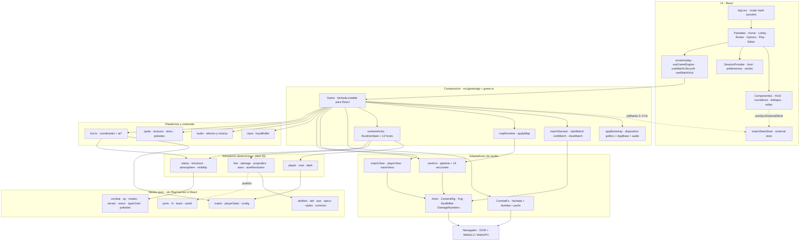

### Qué hace cada bloque

| Bloque | Responsabilidad | Por qué está separado |
| --- | --- | --- |
| **UI React** | Rutas, pantallas, HUD, editor y store de estadísticas. | No simula ni toca el estado mutable; recibe snapshots. |
| **`Game`** | Fachada pública, bucle de frame y orquestación. | React mantiene una API estable aunque cambie el interior. |
| **`app/`** | Bootstrap, sesión de partida, mapa y hosts. | Es el único composition root; el grafo se construye una vez. |
| **`sim/`** | Avance determinista con paso fijo. | Testeable sin DOM, cámara ni PlayCanvas. |
| **`core/`** | Tipos, reglas y contratos puros. | Cero dependencias del motor; rompe el acoplamiento dominio-render. |
| **`render/`** | VFX, mundo, actores, niebla y cámaras. | Los cambios visuales no arrastran reglas de combate. |
| **Plataforma** | Input, audio, sprites, texturas y bots. | Adaptadores reemplazables y con estado propio. |

## 2. Regla de dependencias

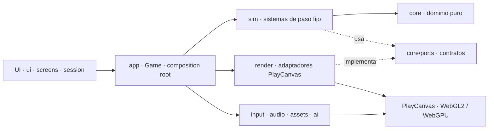

| Capa | Puede importar | No puede importar |
| --- | --- | --- |
| `core/**` | Solo `core/**` y tipos estándar. | `playcanvas`, `react`, `sim/**`, `render/**`, `app/**`, `ui/**`. |
| `sim/**` | `core/**`, contratos y utilidades puras. | `render/**`, `ui/**`, `screens/**`, `react`. |
| `render/**` | `core/**`, `core/ports`, PlayCanvas y utilidades visuales. | `ui/**`, `screens/**`, `session/**`. |
| `app/**` | Todas las capas: es el composition root. | Nada prohibido por diseño, pero mantiene la fachada delgada. |
| `ui/**`, `screens/**` | `Game`, view-models y stores públicos. | `sim/**` y detalles internos de `core/**`. |

`node scripts/check-architecture.mjs` verifica dirección de capas, ciclos de
runtime, ciclos de tipos y tamaño máximo de archivo. Hoy termina con
`Arquitectura OK` y sin ciclos.

## 3. Composition root: `Game`, `RuntimeState` y hosts

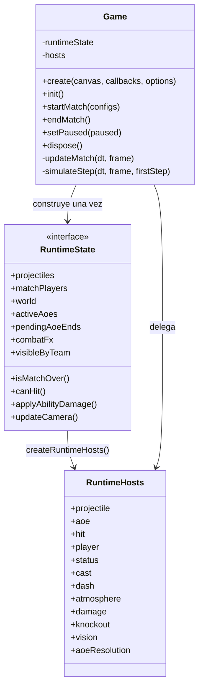

`Game` crea **un único** `RuntimeState` con getters y callbacks y, a partir de
él, **un único** `RuntimeHosts`. Los sistemas reciben su host, no la clase
completa: no hay `this.game` dentro de `sim/**`. Los getters existen porque el
estado se reemplaza en bloque al empezar o limpiar una partida (arrays nuevos),
y así los hosts siguen siendo estables.

| Host | Sistema | Responsabilidad |
| --- | --- | --- |
| `projectile` | `sim/projectiles` | Avance, colisión e impacto de proyectiles. |
| `aoe` | `sim/aoes` | Áreas `overTime` y `onEnd` diferidos. |
| `hit` | `sim/hits` | Golpes instantáneos, dash y melé diferidos. |
| `player` | `sim/player` | Movimiento, timers, cámara, respawn y casteo. |
| `status` | `sim/status` | Regeneración y goteo de participación. |
| `cast` | `sim/cast` | Reloj del casteo, pose de impacto y animación. |
| `dash` | `sim/dash` | Desplazamiento y sincronización del dash. |
| `atmosphere` | `sim/atmosphere` | Daño residual del clima. |
| `damage` | `sim/damage` | Inmunidad, fórmula, slow, daño en el tiempo, buffs, escudo, XP y KO. |
| `knockout` | `sim/knockout` | KO, respawn, marcador y evento al modo. |
| `vision` | `render/visionView` | Niebla, copias visibles y máscara por equipo. |
| `aoeResolution` | `sim/aoeResolution` | Contexto de área, callbacks y eventos. |

## 4. Bucle de frame

El render corre a la tasa del navegador; la simulación avanza en pasos fijos de
`1/60 s`, con un máximo de pasos por frame para no entrar en espiral.

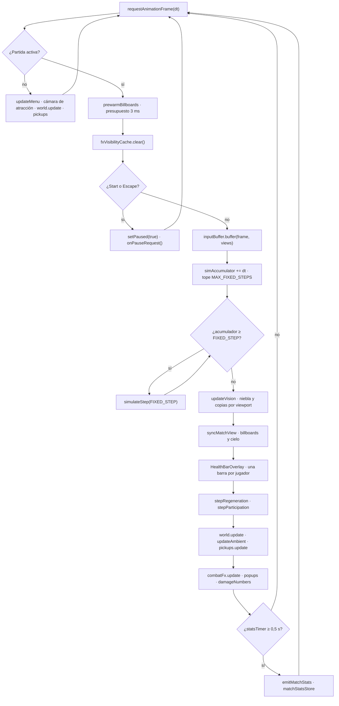

Puntos clave:

- `dt` del render no entra en las reglas: la simulación siempre ve `1/60`.
- Las acciones de borde (habilidades, rueda, giro) se acumulan en
  `inputBuffer` para no perderse en frames sin paso.
- La niebla se resuelve **antes** de sincronizar copias, así las copias ocultas
  no pagan posición, animación ni billboard.
- Las estadísticas del HUD salen a 2 Hz; React nunca lee estado mutable por
  frame.

## 5. Orden del paso fijo

El orden es parte del comportamiento: si cambia, cambian los intercambios y los
empates de daño.

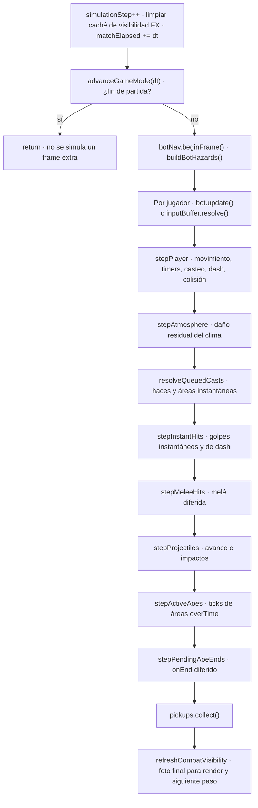

Cada fase comprueba `matchOver` antes de ejecutarse: un KO en un paso no deja
que las fases siguientes sigan aplicando daño en el mismo instante.

## 6. Ciclo de vida de una partida

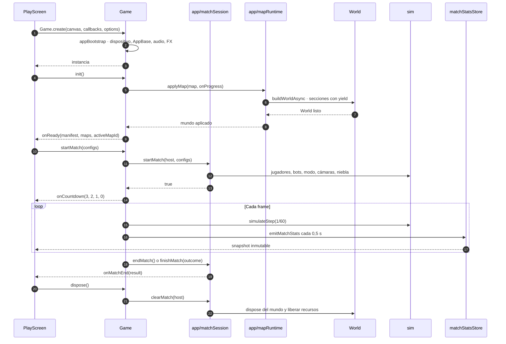

`Game` conserva la superficie pública que usa React:

```ts
Game.create(canvas, callbacks, options): Promise<Game>
game.init(): Promise<void>
game.startMatch(configs): boolean
game.endMatch(): void
game.setPaused(paused: boolean): void
game.dispose(): void
```

## 7. Ciclo de una habilidad

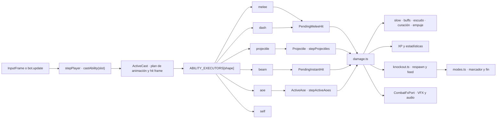

- `abilities.ts` es un catálogo **data-driven**: añadir una habilidad no toca el
  motor.
- `abilityExecutors.ts` es un **Strategy + Registry** por forma; añadir una
  forma nueva es registrar una función.
- `modes.ts` es un **Strategy** por modo (`tdm`, `koth`): `Game` solo reparte
  eventos y aplica el resultado.

## 8. IA de bots

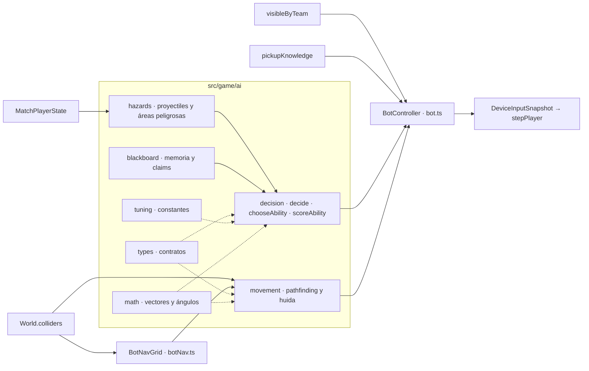

`BotController.update()` devuelve la misma instantánea de entrada que un humano.
Así la simulación tiene una sola ruta de entrada y los bots no reciben trato
especial dentro de `stepPlayer`.

## 9. Generación de mundo

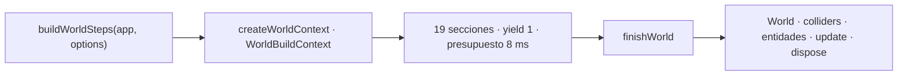

Secciones, en el orden real de ejecución:

| Grupo | Secciones |
| --- | --- |
| Base | `scene`, `lights`, `ground`, `water` |
| Biomas y decoración | `trees`, `barriers`, `desertDust`, `ice`, `fire`, `grass`, `flowers`, `butterflies`, `paramo`, `lightning`, `ghost` |
| Cierre | `bases`, `sky`, `weather`, `contactShadow` |

Módulos compartidos del generador:

| Módulo | Papel |
| --- | --- |
| `render/world/context.ts` | Estado compartido, salidas y disposables. |
| `render/world/random.ts` | RNG determinista. |
| `render/world/tuning.ts` | Constantes de generación. |
| `render/world/surfaces.ts` | Mallas de superficie reutilizables. |
| `render/world/foliage.ts` | Follaje instanciado, viento y paletas. |
| `render/world/butterfly.ts` / `lightning.ts` | Estado y animación de mariposas y rayos. |
| `render/world/worldTextures.ts` / `worldDetailTextures.ts` | Texturas procedurales troceadas. |
| `render/world/ambientParticles.ts` | Lotes ambientales. |
| `render/world/options.ts` / `types.ts` | Opciones, hooks y tipo `World`. |
| `render/world/pickupPlacement.ts` | Validación de posición de objetos. |

Se conservan los 26 `yield 1`, el consumo de azar, el orden de creación y la
limpieza determinista.

## 10. VFX

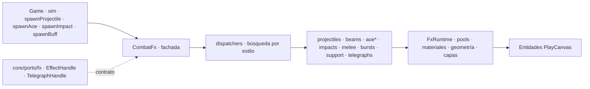

La fachada mantiene la API histórica. Las fábricas se eligen **al lanzar** el
efecto, no por frame. Los pools, materiales y la resolución de capas viven en
`FxRuntime`.

## 11. UI, HUD y editor

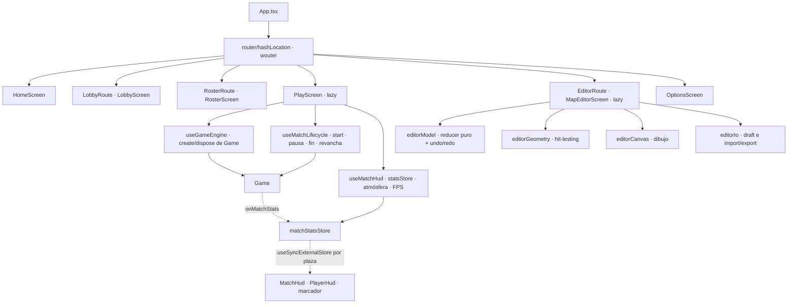

`PlayCanvas` y el editor se cargan con `lazy()`: el bundle principal no incluye
el motor 3D. `PlayScreen` compone hooks; no simula ni guarda estado del motor en
`useState`.

## 12. Mapa de carpetas

```text
src/
├─ main.tsx · App.tsx          # arranque y rutas
├─ router/                     # hash location
├─ session/                    # contexto, boot, preferencias
├─ screens/                    # pantallas y hooks de play
│  └─ play/                    # engine, lifecycle, HUD, stage, diálogos
├─ ui/                         # HUD, componentes y editor
│  └─ editor/                  # modelo, geometría, canvas, IO, toolbar
├─ performance/                # entrada del benchmark de frame
└─ game/
   ├─ game.ts                  # fachada Game
   ├─ app/                     # bootstrap, sesión, mapa, hosts
   ├─ core/                    # dominio puro y puertos
   │  ├─ abilities/            # def, aoe, specs, styles, common
   │  ├─ match/                # playerState y configuración
   │  ├─ ports/                # contratos de FX
   │  └─ __tests__/            # tests puros
   ├─ sim/                     # sistemas de paso fijo
   ├─ render/
   │  ├─ fx/                   # CombatFx y familias
   │  └─ world/                # pipeline, contexto y secciones
   ├─ ai/                      # módulos de decisión y navegación
   ├─ abilities.ts             # catálogo data-driven
   ├─ abilityExecutors.ts      # Strategy + Registry por forma
   ├─ modes.ts                 # Strategy por modo de juego
   ├─ matchState.ts            # estado mutable de la partida
   └─ world.ts                 # pipeline del generador de mundo
```

Tamaños actuales (sin tests):

| Zona | Líneas | Archivos |
| --- | ---: | ---: |
| `src/game/core` | 2.007 | 18 |
| `src/game/sim` | 2.202 | 12 |
| `src/game/app` | 1.108 | 3 |
| `src/game/ai` | 1.811 | 7 |
| `src/game/render` | 17.939 | 62 |
| `src/game` (total) | 56.494 | 166 |
| `src/ui` | 7.470 | 32 |
| `src/screens` | 2.074 | 12 |
| `src/session` | 954 | 3 |

Archivos que antes concentraban la arquitectura:

| Archivo | Antes | Ahora |
| --- | ---: | ---: |
| `game/combatFx.ts` | 13.069 | 15 (puente) |
| `game/game.ts` | 5.871 | 3.657 |
| `game/bot.ts` | 5.525 | 4.499 |
| `game/world.ts` | 4.046 | 361 |
| `ui/MapEditorScreen.tsx` | 2.189 | 1.191 |
| `screens/PlayScreen.tsx` | 954 | 322 |

## 13. Propiedad del estado

| Estado | Dueño | Consumidores |
| --- | --- | --- |
| `MatchPlayerState[]` | `game.ts` + `core/match/playerState` | `sim/**`, `render/**`, bots. |
| `PlayerView` (cámara, copias, barra, viewport) | `render/playerView` | `matchView`, `visionView`, overlay de barras. |
| `World` (colliders, entidades, update) | `world.ts` | Simulación, render, bots y objetos. |
| `RuntimeState` + `RuntimeHosts` | `app/runtimeHosts.ts` | Todos los sistemas. |
| `ActiveCast`, `Projectile`, `ActiveAoe` | `matchState.ts` | Sistemas de simulación y FX. |
| `visibleByTeam` | `sim/visibility` | Bots, regeneración y render. |
| `matchStatsStore` | `ui/matchStatsStore.ts` | Componentes del HUD. |
| Sesión y preferencias | `session/SessionProvider.tsx` | Pantallas y ajustes. |
| `EditorMap` e historial | `ui/editor/editorModel.ts` | Editor y tests. |

Regla: **el estado de simulación no contiene objetos de render**. La cámara,
las copias y las barras viven en el sidecar `PlayerView`; la simulación solo
guarda `cameraYaw` como número para la IA.

## 14. Guardarraíles y verificación

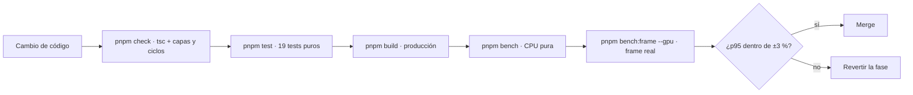

| Comando | Qué comprueba |
| --- | --- |
| `pnpm check` | TypeScript, dirección de capas, ciclos de runtime/tipos y tamaño máximo. |
| `pnpm test` | Daño, geometría de áreas, XP, modos, peligros de IA y modelo del editor. |
| `pnpm build` | Build de producción con `tsc -b` y Vite. |
| `pnpm bench` | Bucle de simulación puro en Node. |
| `pnpm bench:frame --all --seconds 5 --gpu` | FPS, p50/p95 y máximos reales en Chrome headless. |

Criterio de aceptación: mismos draw calls, ninguna tarea larga nueva, memoria
estable y p95 dentro del ±3 %. Las referencias están en
`docs/performance/baseline.md` y `docs/performance/frame-baseline.md`.

## 15. Decisiones que explica el diagrama

1. **Monolito modular, no microservicios ni ECS.** El estado caliente sigue
   siendo plano y reutilizado; los patrones ordenan el código sin añadir
   indirección por frame.
2. **Un composition root.** `Game.create` construye el grafo una vez; no hay
   contenedor DI ni service locator.
3. **Puertos solo donde hacían falta.** `core/ports/fx.ts` rompe la dependencia
   dominio-render y se borra al compilar.
4. **Hosts explícitos.** Cada sistema declara lo que necesita; `Game` no se pasa
   a sí mismo como dios.
5. **Registros en el evento.** Habilidades, VFX, modos y secciones de mundo se
   resuelven al lanzar o al cargar, no en el bucle interno.
6. **React no simula.** El HUD recibe snapshots inmutables a 2 Hz y se suscribe
   por plaza con `useSyncExternalStore`.
7. **Todo se mide.** La arquitectura no es un fin: el p95 y los draw calls son
   criterios de aceptación.
