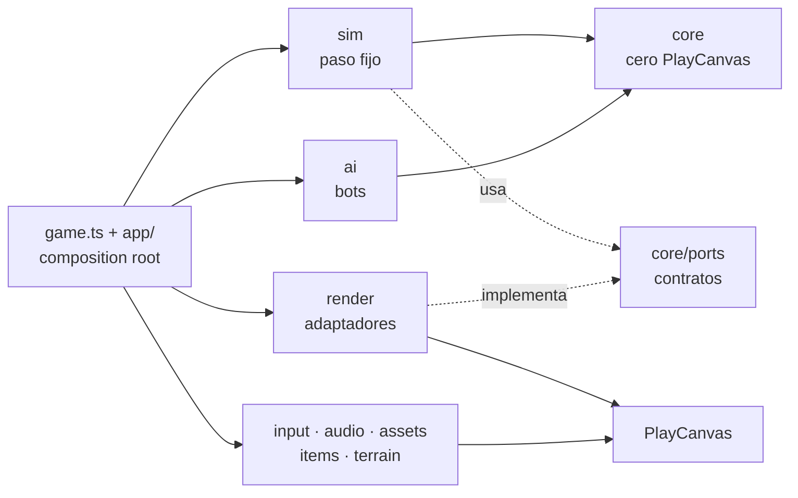
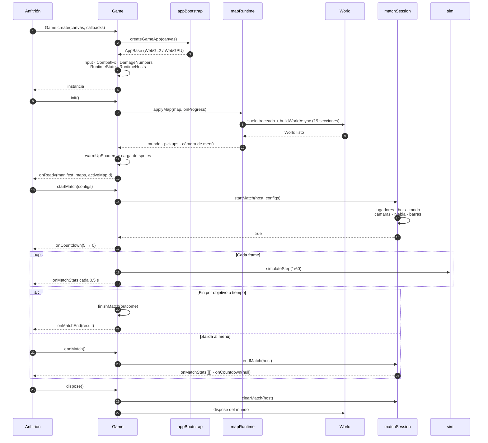
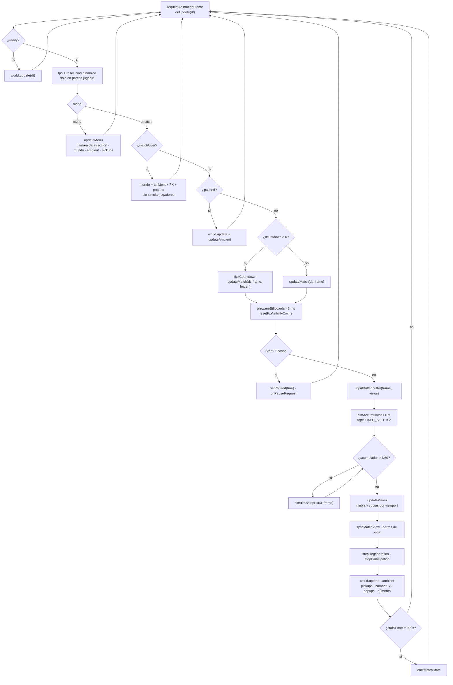
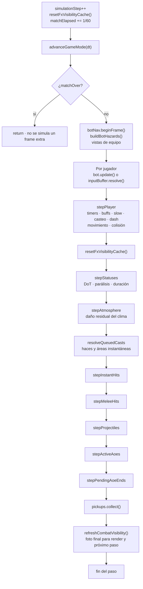
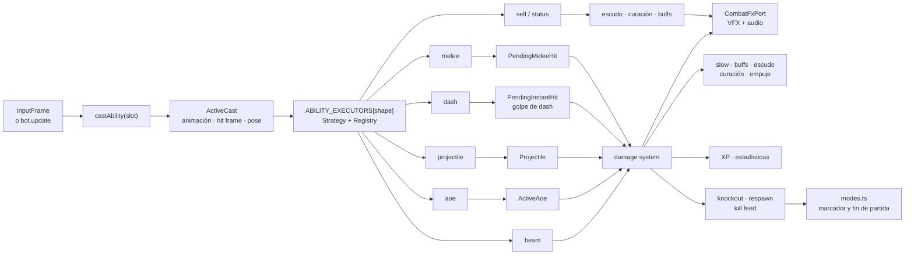
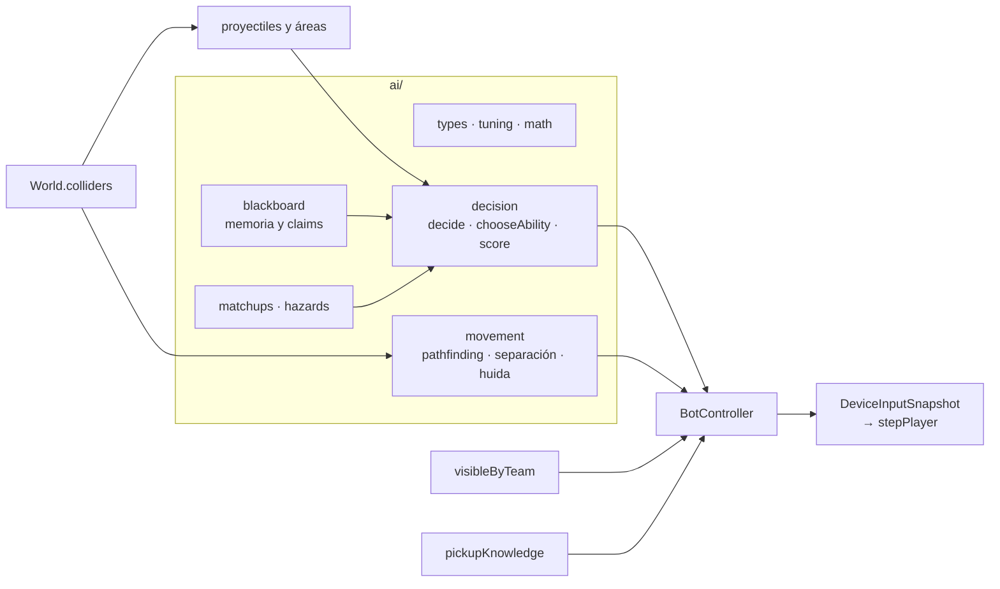

# Arquitectura del juego (sin React)

> Vista del motor: qué hay dentro de `src/game`, cómo se compone y cómo avanza
> una partida. **No incluye** `src/ui`, `src/screens`, `src/session` ni React.
> La frontera es `Game`: recibe un canvas y expone callbacks; todo lo demás es
> juego.

## Leyenda

- **Flecha continua:** dependencia o llamada en tiempo de ejecución.
- **Flecha discontinua:** contrato de tipos, puerto o suscripción.
- `core` es el único dominio sin PlayCanvas.
- `sim` avanza el estado con paso fijo y no conoce cámara, DOM ni render.
- `render` adapta estado y eventos a PlayCanvas; `app` compone el grafo.

Resumen en una línea:

```text
app/Game ──► RuntimeHosts ──► sim ──► core
    │              ▲
    ├──► render ───┘
    ├──► ai ──────────────► core
    ├──► input / audio / assets / items
    └──► PlayCanvas (WebGL2 / WebGPU)
```

## 1. Vista general del motor

```mermaid
flowchart TB
  subgraph host["Frontera del motor"]
    canvas["Canvas<br/>WebGL2 / WebGPU"]
  end

  subgraph composition["Composición · game.ts + app/"]
    game["Game<br/>fachada · bucle de frame · simulación autoritativa"]
    bootstrap["appBootstrap<br/>GraphicsDevice + AppBase"]
    session["matchSession<br/>startMatch · endMatch · clearMatch"]
    mapRuntime["mapRuntime<br/>applyMap · ciclo del mundo"]
    runtimeState["RuntimeState<br/>estado compartido con getters"]
    runtimeHosts["RuntimeHosts<br/>12 hosts explícitos"]
  end

  subgraph simulation["Simulación determinista · paso fijo 1/60 s"]
    simPlayer["player<br/>timers · buffers · movimiento<br/>casteo · dash · colisión"]
    simCombat["damage · hits · projectiles<br/>aoes · aoeResolution"]
    simWorld["status · knockout<br/>atmosphere · visibility"]
  end

  subgraph core["Dominio puro · core/ + puentes"]
    coreMatch["match<br/>playerState · config · assists"]
    coreAbilities["abilities<br/>def · aoe · specs · styles"]
    coreRules["combat · xp · typeChart<br/>terrain · vision · pokedex"]
    corePorts["ports<br/>fx · team · world"]
  end

  subgraph presentation["render · adaptadores PlayCanvas"]
    matchView["matchView · playerView<br/>visionView · matchStats"]
    effects["CombatFx<br/>fachada · familias · pools"]
    worldBuilder["world<br/>builder + 19 secciones"]
    sceneParts["Actor · CameraRig · Fog<br/>HealthBar · DamageNumbers"]
  end

  subgraph intelligence["ai · bots"]
    bot["BotController<br/>devuelve DeviceInputSnapshot"]
    aiModules["decision · movement<br/>hazards · matchups · blackboard"]
  end

  subgraph platform["Plataforma y contenido"]
    input["input · inputBuffer"]
    audio["audio · audioSettings"]
    assets["modelos · textures<br/>pokedex · roster"]
    content["abilities · abilityExecutors<br/>modes · items · pickups"]
    terrain["terrain · map · multiplayer"]
    atmosphere["atmosphere · fog · pickups"]
  end

  pc["PlayCanvas<br/>AppBase + GraphicsDevice"]

  game --> bootstrap
  game --> session
  game --> mapRuntime
  game --> runtimeState
  runtimeState --> runtimeHosts

  runtimeHosts --> simPlayer
  runtimeHosts --> simCombat
  runtimeHosts --> simWorld
  simPlayer --> coreMatch
  simCombat --> coreAbilities
  simCombat --> coreRules
  simWorld --> coreRules
  simCombat -.->|"usa"| corePorts

  game --> matchView
  game --> effects
  mapRuntime --> worldBuilder
  session --> matchView
  matchView --> sceneParts
  worldBuilder --> sceneParts
  effects -.->|"implementa"| corePorts

  game --> bot
  bot --> aiModules
  aiModules --> coreMatch
  aiModules --> simWorld

  game --> input
  game --> audio
  game --> assets
  game --> content
  game --> terrain
  game --> atmosphere
  session --> content
  session --> assets

  effects --> pc
  sceneParts --> pc
  worldBuilder --> pc
  pc --> canvas
```



### Qué hace cada bloque

| Bloque | Responsabilidad | Por qué está separado |
| --- | --- | --- |
| **`Game`** | Fachada, bucle de frame, simulación autoritativa y estado caliente. | Un único punto de entrada para el anfitrión. |
| **`app/`** | Bootstrap, sesión de partida, mapa y hosts. | Es el composition root: el grafo se construye una vez. |
| **`sim/`** | Sistemas de paso fijo. | Testeables sin DOM, cámara ni PlayCanvas. |
| **`core/`** | Tipos, reglas y contratos puros. | Cero dependencias del motor; rompe dominio ↔ render. |
| **`render/`** | Mundo, FX, actores, niebla, cámaras y HUD 3D. | Los cambios visuales no arrastran reglas de combate. |
| **`ai/`** | Decisión, navegación y memoria de bots. | Entra por la misma ruta de input que un humano. |
| **Plataforma** | Input, audio, sprites, texturas, objetos y terreno. | Adaptadores con estado propio y reemplazables. |

## 2. Regla de dependencias



| Capa | Puede importar | No puede importar |
| --- | --- | --- |
| `core/**` | Solo `core/**` y tipos estándar. | `playcanvas`, `react`, `sim/**`, `render/**`, `app/**`. |
| `sim/**` | `core/**`, `sim/**` y módulos puros de `src/game`. | `render/**`, `audio/**`, `ui/**`, `screens/**`. |
| `render/**` | `core/**`, `render/**` y módulos puros de `src/game`. | `sim/**`, `ui/**`, `screens/**`, `session/**`. |
| `app/**` | Todas las capas del motor. | — (es el composition root). |
| `ai/**` | `core/**`, tipos de simulación y utilidades puras. | `render/**`, `ui/**`. |

`node scripts/check-architecture.mjs` verifica la dirección de capas, los ciclos
de runtime y los ciclos de tipos.

## 3. Arranque y ciclo de partida



Puntos clave:

- `Game.create` es asíncrono porque el dispositivo gráfico lo es; el grafo se
  construye una sola vez en el constructor.
- `init` carga mapas, objetos, mundo, shaders y sprites. El mundo nuevo se
  construye aparte y solo se activa cuando está completo.
- `startMatch` valida sprites, crea modo, clima, jugadores, vistas, bots y
  niebla; después la cuenta atrás congela la simulación 5 segundos.
- `dispose` destruye partida, mundo, FX, audio, texturas y la aplicación.

## 4. Bucle de frame

El render corre a la tasa del navegador; la simulación avanza en pasos fijos de
`1/60 s`, con un máximo de `2` pasos por frame.



Reglas del bucle:

- El `dt` del render nunca entra en las reglas: la simulación siempre ve
  `1/60`.
- Las acciones de borde (habilidad, pausa, giro) se acumulan en `inputBuffer`
  para no perderse en frames de 144 Hz sin paso de simulación.
- La niebla se resuelve **antes** de sincronizar copias; las copias ocultas no
  pagan posición, animación ni billboard.
- En pausa, menú y fin de partida el mundo sigue respirando, pero no se simula
  combate.
- Las estadísticas salen a 2 Hz; el anfitrión nunca lee estado mutable por
  frame.

## 5. Orden exacto del paso fijo

El orden es parte del comportamiento: cambiarlo cambia intercambios de daño,
empates y muertes.



Cada fase comprueba `matchOver` antes de ejecutarse: un KO en un paso no deja
que las fases siguientes sigan aplicando daño en el mismo instante.

## 6. Ciclo de una habilidad



- `abilities.ts` es un catálogo **data-driven**: añadir una habilidad no toca el
  motor.
- `abilityExecutors.ts` es un **Strategy + Registry** por forma; la resolución
  de efectos vive en `abilityResolve.ts` y cada `AbilityDef` declara su
  `resolve` (con default por forma).
- `modes.ts` es un **Strategy** por modo (`tdm`, `koth`): `Game` solo reparte
  eventos y aplica el resultado.
- La simulación depende de `core/ports/fx`, no de `CombatFx`; el puerto se borra
  al compilar.

## 7. IA de bots

Los bots no tienen una ruta privilegiada: devuelven la misma
`DeviceInputSnapshot` que un humano y entran por `stepPlayer`.



## 8. Propiedad del estado

| Estado | Dueño | Consumidores |
| --- | --- | --- |
| `MatchPlayerState[]` | `game.ts` + `core/match/playerState` | `sim/**`, `render/**`, bots. |
| `Projectile[]`, `ActiveAoe[]`, `Pending*` | `game.ts` + `matchState` | `sim/**`, FX. |
| `RuntimeState` + `RuntimeHosts` | `app/runtimeHosts.ts` | Todos los sistemas. |
| `World` (colliders, entidades, update) | `world.ts` | Simulación, render, bots y objetos. |
| `PlayerView` (cámara, copias, barra) | `render/playerView` | `matchView`, `visionView`, barras. |
| `visibleByTeam` | `sim/visibility` | Bots, regeneración y render. |
| `fogMasks` / `fogViews` | `game.ts` + `fog.ts` | `visionView`. |
| `InputFrame` / búfer de acciones | `input.ts` + `inputBuffer.ts` | `sim/player`. |
| Memoria y vista de bots | `ai/**` | `BotController`. |
| `pickupKnowledge` | `pickupKnowledge.ts` | Bots. |

Regla: **el estado de simulación no contiene objetos de render**. La cámara,
las copias y las barras viven en el sidecar `PlayerView`; la simulación solo
guarda `cameraYaw` como número para la IA.

## 9. Hosts de simulación

`RuntimeState` expone getters porque el estado se reemplaza en bloque al
empezar o limpiar una partida; así los hosts siguen siendo estables.

| Host | Sistema | Responsabilidad |
| --- | --- | --- |
| `projectile` | `sim/projectiles` | Avance, colisión e impacto de proyectiles. |
| `aoe` | `sim/aoes` | Áreas `overtime-*` y `onEnd` diferidos. |
| `hit` | `sim/hits` | Golpes instantáneos, dash y melé diferidos. |
| `player` | `sim/player` | Movimiento, timers, cámara, respawn y casteo. |
| `status` | `sim/status` | Regeneración y goteo de participación. |
| `cast` | `sim/cast` | Reloj del casteo, pose de impacto y animación. |
| `dash` | `sim/dash` | Desplazamiento y sincronización del dash. |
| `atmosphere` | `sim/atmosphere` | Daño residual del clima. |
| `damage` | `sim/damage` | Inmunidad, fórmula, slow, estados, buffs, escudo, XP y KO. |
| `knockout` | `sim/knockout` | KO, respawn, marcador y evento al modo. |
| `vision` | `render/visionView` | Niebla, copias visibles y máscara por equipo. |
| `aoeResolution` | `sim/aoeResolution` | Contexto de área, callbacks y eventos. |

## 10. Mapa de módulos

```text
src/game/
├─ game.ts                 # fachada Game + bucle + estado caliente
├─ appBootstrap.ts         # dispositivo gráfico + AppBase
├─ app/
│  ├─ matchSession.ts      # start / end / clear de partida
│  ├─ mapRuntime.ts        # applyMap y ciclo del mundo
│  └─ runtimeHosts.ts      # RuntimeState + 12 hosts
├─ core/
│  ├─ abilities/           # def · aoe · specs · styles
│  ├─ match/               # playerState · config · assists
│  ├─ ports/               # fx, team, world
│  └─ typeChart · xp · terrain · vision · pokedex
├─ sim/
│  ├─ player · cast · dash · damage
│  ├─ hits · projectiles · aoes · aoeResolution
│  └─ status · knockout · atmosphere · visibility
├─ render/
│  ├─ matchView · playerView · visionView · matchStats
│  ├─ fx/                  # CombatFx · familias · pools · dispatchers
│  └─ world/               # builder · contexto · 19 secciones
├─ ai/
│  ├─ decision · movement · hazards · matchups
│  └─ blackboard · math · tuning · types
├─ bot.ts · botNav.ts      # controlador y rejilla de navegación
├─ abilities.ts            # catálogo data-driven
├─ abilityExecutors.ts     # Strategy + Registry por forma
├─ modes.ts                # Strategy por modo (tdm / koth)
├─ input.ts · inputBuffer.ts
├─ audio.ts · textures.ts · model.ts
├─ items.ts · pickups.ts · pickupKnowledge.ts
├─ world.ts · map.ts · mapEditor.ts
└─ matchState.ts           # puente de tipos de playerState
```

## 11. Guardarraíles

| Comando | Qué comprueba |
| --- | --- |
| `pnpm check` | TypeScript, dirección de capas, ciclos de runtime/tipos y tamaño máximo. |
| `pnpm test` | Daño, geometría de áreas, XP, modos, peligros de IA y movimiento. |
| `pnpm build` | Build de producción con `tsc -b` y Vite. |
| `pnpm bench` | Bucle de simulación puro en Node. |
| `pnpm bench:frame` | FPS, p50/p95 y draw calls reales en Chrome headless. |

Criterio de aceptación: mismos draw calls, ninguna tarea larga nueva, memoria
estable y p95 dentro del ±3 %. Las referencias viven en
`docs/performance/baseline.md` y `docs/performance/frame-baseline.md`.

## 12. Decisiones que explica el diagrama

1. **Monolito modular, no ECS.** El estado caliente sigue siendo plano y
   reutilizado; los patrones ordenan el código sin indirección por frame.
2. **Un composition root.** `Game.create` construye el grafo una vez; no hay
   contenedor DI ni service locator.
3. **Puertos solo donde hacían falta.** `core/ports/fx.ts` rompe la dependencia
   dominio-render y se borra al compilar.
4. **Hosts explícitos.** Cada sistema declara lo que necesita; `Game` no se pasa
   a sí mismo como dios.
5. **Registros en el evento.** Habilidades, VFX, modos y secciones de mundo se
   resuelven al lanzar o al cargar, no en el bucle interno.
6. **La IA entra por el input.** Bots y humanos comparten `stepPlayer`; no hay
   trato especial dentro de la simulación.
