# Arquitectura propuesta: monolito modular con núcleo funcional

> Objetivo: ordenar el código con patrones explícitos **sin añadir coste en el
> bucle de juego**. No es una reescritura ni una migración a ECS: es una
> extracción gradual de responsabilidades sobre lo que ya funciona.

> Los diagramas de todas las capas están al final, en la Parte II.

## 1. Diagnóstico

### Lo que ya está bien

El proyecto no parte de cero. Ya hay decisiones que conviene conservar:

- `abilityExecutors.ts` es un **Strategy + Registry** por forma de habilidad.
- `modes.ts` es un **Strategy** por modo de juego; `Game` solo reparte eventos.
- `abilities.ts` es un catálogo **data-driven**; añadir una habilidad no toca el
  motor.
- `matchStatsStore.ts` es un **external store** con suscripción por plaza: React
  no se re-renderiza a 60 Hz.
- `CombatFx` ya tiene **pools** de materiales y partículas, caché de mallas y
  fábricas por estilo.
- `buildWorldSteps` ya es un generador troceado que cede el hilo.
- El paso de simulación es fijo y está separado del render.
- **No hay ciclos de dependencia en tiempo de ejecución.**

Eso significa que el problema no es "falta de patrones", sino que los patrones
están concentrados en unos pocos archivos gigantes y el resto del código los
atraviesa.

### Números actuales

| Área | Tamaño | Señal |
| --- | ---: | --- |
| `src/game/combatFx.ts` | 13.069 líneas, ~100 métodos | God class de VFX |
| `src/game/game.ts` | 5.871 líneas, 45 imports | Orquestador, simulación, render, UI, audio y ciclo de vida |
| `src/game/bot.ts` | 5.525 líneas, ~80 métodos | IA entera en una clase |
| `src/game/world.ts` | 4.046 líneas | Un único generador construye todo el mundo |
| `src/ui/MapEditorScreen.tsx` | 2.189 líneas | Modelo, historial, geometría, canvas, IO y JSX |
| `src/game` | 52.833 líneas / 63 archivos | Todo el dominio y los adaptadores juntos |
| `src` | ~63.500 líneas | — |

### El acoplamiento que más duele

Hay **0 ciclos en runtime**, pero **1 componente fuertemente conexo de 17
módulos a nivel de tipos**:

```
world ↔ vision ↔ castPlan ↔ camera ↔ sprite ↔ terrainSpeed ↔ modes ↔
multiplayer ↔ textures ↔ marker ↔ actor ↔ matchState ↔ items ↔ terrain ↔
combatFx ↔ aoeEffect ↔ abilities
```

La causa principal es que `matchState.ts` —el estado de la simulación— importa
tipos de presentación:

- `Actor` (billboard de PlayCanvas)
- `CameraRig` (cámara)
- `HealthBarArt` (canvas 2D)
- `EffectHandle`, `FxHandle`, `TelegraphHandle` (VFX)

Es decir: **el dominio depende del render**. Eso impide testear la simulación
sin PlayCanvas, complica un futuro multijugador/replay y hace que cualquier
cambio visual pueda arrastrar tipos de combate.

### Síntomas en el día a día

- Un cambio de VFX obliga a navegar 13.000 líneas.
- Un cambio de regla de combate vive en `game.ts`, mezclado con HUD, audio y
  cámaras.
- El editor de mapas no se puede testear sin montar React.
- Es difícil saber qué puede importar qué: todo importa todo.
- Los archivos grandes generan conflictos y hacen costoso el *code review*.

## 2. Principios

1. **Núcleo funcional, shell imperativo.**
   La simulación es determinista y no conoce PlayCanvas ni React. El render, el
   audio y el input son adaptadores.
2. **Composición, no herencia.**
   `CombatFx` no se parte en subclases; se parte en funciones y registros que
   reciben un contexto.
3. **Dependencias explícitas, sin contenedor DI.**
   El grafo se construye una vez en un *composition root*. Nada de
   `reflect-metadata`, decoradores ni *service locator*.
4. **Cero asignaciones nuevas por frame/paso.**
   Los patrones organizan el código; el estado caliente sigue siendo plano,
   reutilizado y con formas estables.
5. **Los patrones solo donde hay un problema real.**
   Nada de ECS completo, event bus global por tick ni capas vacías.
6. **Refactor mecánico y refactor semántico van en commits distintos.**
   Primero mover, después cambiar comportamiento.
7. **Medir antes y después.**
   Build de producción, varios mapas y 1/4/8 vistas. Si el p95 empeora > 3 %, se
   revierte.

## 3. Arquitectura objetivo

Monolito modular, no microservicios ni monorepo:

```
src/
├─ game/
│  ├─ core/                 # Dominio puro: sin playcanvas, sin react
│  │  ├─ match/             # PlayerState, MatchState, fases, reglas
│  │  ├─ combat/            # daño, geometría, tipos, xp
│  │  ├─ abilities/         # catálogo, contratos, ejecutores
│  │  ├─ modes/             # TDM, KOTH
│  │  ├─ nav/               # rejilla y pathfinding (sin render)
│  │  └─ ports/             # interfaces estrechas: FxPort, WorldPort, AudioPort
│  ├─ sim/                  # Sistemas deterministas de paso fijo
│  │  ├─ context.ts
│  │  ├─ pipeline.ts
│  │  └─ systems/           # playerStep, casts, projectiles, aoes, hits, vision
│  ├─ render/               # Adaptadores PlayCanvas
│  │  ├─ fx/                # CombatFx fachada + familias + pools
│  │  ├─ world/             # constructor y secciones/biomas
│  │  ├─ actor/ fog/ hud/ marker/
│  ├─ app/                  # Composición y ciclo de vida
│  │  ├─ Game.ts            # Fachada pública (API actual para React)
│  │  ├─ bootstrap.ts
│  │  ├─ mapRuntime.ts
│  │  ├─ matchSession.ts
│  │  └─ presenter.ts
│  ├─ ai/                   # Bots: percepción, navegación, decisiones
│  ├─ audio/ input/ assets/ # Adaptadores existentes
│  └─ matchState.ts         # (temporal) re-export durante la migración
├─ ui/
├─ screens/
└─ session/
```

No hace falta mover todo el primer día. La estructura marca **dónde debería
vivir el código nuevo** y **hacia dónde se mueve el existente** cuando se toca.

### Regla de dependencias

```
UI (React) ──► app/Game (fachada) ──► sim ──► core
                     │                  ▲
                     └──► render/audio/input ──┘
                            (implementan ports)
```

Reglas verificables:

- `core/**` no importa `playcanvas`, `react`, `render/**`, `app/**`, `ui/**`.
- `sim/**` no importa `render/**`, `audio/**`, `ui/**`; usa `core/ports`.
- `render/**` no importa `ui/**`, `screens/**`, `session/**`.
- `ui/**` y `screens/**` no importan `sim/**` ni `core/**` internos; hablan con
  `app/Game` y con view-models públicos.
- `app/**` es el único que puede importar de todas las capas (composition root).
- Sin ciclos de runtime **ni de tipos** entre capas.

Estas reglas se pueden comprobar con un script de imports (ver §8) sin añadir
dependencias ni coste en runtime.

## 4. Patrones y dónde se aplican

| Patrón | Dónde | Coste en runtime | Por qué |
| --- | --- | --- | --- |
| **Facade** | `app/Game.ts` | Una llamada de más por frame (inlinable) | React mantiene la API actual; la lógica se reparte |
| **Composition Root** | `Game.create` / `bootstrap` | Solo al arrancar | Grafo explícito sin contenedor DI |
| **Functional Core** | `core/**` | Cero | Reglas puras y testeables sin PlayCanvas |
| **Systems pipeline** | `sim/pipeline.ts` | Llamadas directas en un `for` estático | Orden explícito, cero dispatch dinámico |
| **Strategy + Registry** | VFX, habilidades, bots, mundo | Una búsqueda O(1) en el evento, no por frame | Añadir un estilo es registrar una función |
| **State Machine** | Partida y casteo | `switch` sobre entero | Elimina booleanos dispersos (`matchOver`, `paused`...) |
| **Ports & Adapters** | FX, mundo, audio, input | Cero: las interfaces se borran al compilar | Rompe el ciclo dominio ↔ render |
| **Command** | Input → simulación | Un objeto plano reutilizado | Test, replay y futura red sin tocar reglas |
| **Object Pool / Flyweight** | FX, proyectiles, popups, eventos | Ahorra GC | Ya existe; se formaliza |
| **Presenter / Outbox** | HUD, stats, kill feed | 2–4 Hz, arrays reutilizados | React nunca ve estado mutable de simulación |
| **Reducer + Selectors** | Editor de mapas | Solo eventos de usuario | Modelo puro, historial y tests |
| **Container / Presentational** | Pantallas React | Cero | JSX delgado; hooks y stores por feature |

## 5. Extracciones concretas

### 5.1. `CombatFx`: fachada + familias + registro

**Ahora:** una clase con lifecycle, materiales, mallas, partículas, pools y ~100
métodos de efectos.

**Después:**

```
render/fx/
├─ CombatFx.ts          # fachada: update, clear, dispose, visibilidad, pools
├─ FxContext.ts         # device, props, cachés, helpers, resolución de capas
├─ materials.ts         # createMaterial, aura, shield, flame, leaf, ice, rock...
├─ geometry/            # createArcMesh, createLightningMesh, createDiscMesh...
├─ projectiles/         # orb, electric, fire, grass, poison, water, ice, rock...
├─ beams/               # electric, fire, water, ice, rock...
├─ aoe/                 # ring, fire, cyclone, blizzard, fissure, burrow...
├─ impacts/             # hit, fire, psychic, steel, fighting, ghost...
├─ auras.ts             # buff, armor, shield, heal
├─ telegraphs.ts
└─ registry.ts          # Record<Style, Factory>
```

La API pública no cambia:

```ts
// app/sim siguen llamando a lo mismo
fx.spawnProjectile(...);
fx.spawnAoe(...);
fx.spawnAoeTelegraph(...);
```

Pero por dentro:

```ts
export interface FxContext {
  readonly app: pc.AppBase;
  readonly device: pc.GraphicsDevice;
  readonly props: FxProps;       // mallas y texturas compartidas
  readonly caches: FxCaches;     // pools y caché de mallas
  readonly layerFor: FxLayerResolver;
  entity(mesh: pc.Mesh, materials: pc.StandardMaterial[], parent?: pc.Entity): pc.Entity;
  material(color: Rgb, opacity: number): pc.StandardMaterial;
  addEffect(root: pc.Entity, materials: pc.StandardMaterial[], life: number, animate?: FxAnimate): void;
}

export type ProjectileFactory = (
  ctx: FxContext,
  args: ProjectileArgs
) => EffectHandle;

export const PROJECTILE_FACTORIES: Record<ProjectileStyle, ProjectileFactory> = {
  orb: spawnOrb,
  electric: spawnElectric,
  fire: spawnFire,
  // ...
};
```

Ventajas:

- El archivo máximo baja a ~1.200 líneas.
- Añadir un VFX nuevo es escribir un archivo y registrarlo.
- El dispatch sigue siendo una búsqueda en un `Record` **al lanzar**, no por
  frame.
- Los pools y la visibilidad quedan en un único sitio.
- Se puede hacer con *codemod* mecánico: mover métodos, cambiar `this.x` por
  `ctx.x`, construir el registro.

**Coste:** las fábricas reciben un objeto más. Es una llamada por proyectil/área,
no por frame. Ninguna asignación nueva si `args` se reutiliza o se pasa por
parámetros.

### 5.2. `Game`: fachada y descomposición

**Ahora:** `Game` es entrada, init, mapas, partida, simulación, render, niebla,
HUD, audio, bots, estadísticas y cierre.

**Después:**

```
app/
├─ Game.ts            # fachada: create, init, startMatch, endMatch, dispose
├─ bootstrap.ts       # canvas, WebGL/WebGPU, audio, manifest, map index, warmup
├─ mapRuntime.ts      # applyMap, suelo cacheado, ciclo del World, atmósfera
├─ matchSession.ts    # start/end/clear, modo, cuenta atrás, objetivo, pausa
├─ presenter.ts       # callbacks a React, stats, kill feed, countdown
├─ matchView.ts       # cámaras, copias, niebla, barras, marcadores
└─ sim/
   ├─ MatchSimulation.ts
   ├─ context.ts
   ├─ pipeline.ts
   └─ systems/
      ├─ playerStep.ts       # movimiento, timers, cámara, respawn
      ├─ cast.ts             # castAbility, queued casts, dash, interrupciones
      ├─ damage.ts           # daño, aoe, knockback, popups, XP, KO
      ├─ projectiles.ts
      ├─ aoes.ts
      ├─ pickups.ts
      └─ vision.ts
```

`Game` conserva exactamente la superficie que usa `PlayScreen`:

```ts
class Game {
  static create(canvas, callbacks, options): Promise<Game>;
  init(): Promise<void>;
  startMatch(configs): boolean;
  endMatch(): void;
  setPaused(paused: boolean): void;
  dispose(): void;
}
```

Y delega:

```ts
async init() {
  await this.bootstrap.load();
  await this.mapRuntime.loadInitialMap();
  this.ready = true;
  this.presenter.ready();
}
```

**Pipeline de simulación, sin ECS:**

```ts
export interface SimContext {
  readonly dt: number;
  readonly players: MatchPlayerState[];
  readonly projectiles: Projectile[];
  readonly world: WorldPort;
  readonly fx: FxPort;
  readonly events: MatchEventSink;
  readonly bots: ReadonlyMap<number, BotController>;
}

export type SimSystem = (ctx: SimContext) => boolean; // false = partida cerrada

const SYSTEMS: readonly SimSystem[] = [
  stepPlayers,
  resolveQueuedCasts,
  resolveInstantHits,
  resolveMeleeHits,
  stepProjectiles,
  stepAoes,
  updatePendingAoeEnds,
  collectPickups,
  refreshVisibility
];

export function runStep(ctx: SimContext): void {
  for (const system of SYSTEMS) {
    if (!system(ctx)) return;
  }
}
```

- Array `const` y funciones directas: sin `bind`, sin closures por paso.
- `ctx` se crea una vez y se mutan sus campos; no se asigna un contexto por tick.
- El orden actual se conserva exactamente.
- Las salidas tempranas por `matchOver` se modelan devolviendo `false`.

**State machine de partida:**

```ts
type MatchPhase = 'idle' | 'countdown' | 'playing' | 'paused' | 'finished';
```

Sustituye la combinación actual de `mode`, `paused`, `matchOver`, `countdown`,
`winner` y `frozen`. La transición se valida en un único sitio.

### 5.3. `world.ts`: secciones y biomas

**Ahora:** un generador de 4.000 líneas que hace texturas, partículas, zonas,
cordilleras, bases, decoración, colisiones y limpieza.

**Después:**

```
render/world/
├─ worldBuilder.ts      # orquesta secciones y devuelve World
├─ context.ts           # WorldBuildContext + disposables + colliders
├─ sections/
│  ├─ textures.ts
│  ├─ particles.ts
│  ├─ ground.ts
│  ├─ water.ts
│  ├─ mountains.ts
│  ├─ bases.ts
│  ├─ zones.ts
│  ├─ foliage.ts
│  ├─ ice.ts
│  └─ lights.ts
├─ biomes/              # desierto, bosque, pantano, caldera, nieve...
└─ meshes/              # geometrías reutilizables
```

Se conserva el troceado actual:

```ts
export type WorldSection = (
  ctx: WorldBuildContext
) => Generator<number, void, void>;

const SECTIONS: readonly WorldSection[] = [
  buildGround,
  buildWater,
  buildMountains,
  buildBases,
  buildZones,
  buildFoliage,
  buildParticles,
  buildLights
];

export function* buildWorldSteps(app, options) {
  const ctx = createWorldContext(app, options);
  for (const section of SECTIONS) yield* section(ctx);
  return finishWorld(ctx);
}
```

- `yield*` mantiene los puntos de cesión y el presupuesto de 8 ms.
- Cada sección registra sus texturas/mallas en `ctx.disposables`; la limpieza
  sigue siendo determinista.
- Un bioma nuevo es un archivo + una entrada en la tabla.
- Se puede verificar con un *golden test*: mismo número y posición de colliders,
  mismos spawns y mismos nombres de entidad.

**Coste:** un generador más por sección, una vez por carga de mapa. Irrelevante
frente a la generación actual y no afecta al frame de juego.

### 5.4. `bot.ts`: coordinador + módulos

**Ahora:** una clase de 5.500 líneas con percepción, memoria de equipo,
navegación, evaluación de combate, soporte, objetivos, objetos y movimiento.

**Después:**

```
ai/
├─ BotController.ts     # coordinator: update() y estado por bot
├─ perception.ts        # enemigos visibles, amenazas, cooldowns observados
├─ blackboard.ts        # memoria de equipo y claims
├─ navigation.ts        # pathfinding, separación, huida de peligros
├─ combat.ts            # assessFight, daño esperado, hit chance
├─ support.ts           # curas, revives, buffs a aliados
├─ objectives.ts        # KOTH, patrulla, puntos de control
├─ pickups.ts           # objetivos de objeto
├─ scoring.ts           # puntuación de habilidades y decisiones
└─ behaviors.ts         # tabla de comportamientos de alto nivel
```

Dos niveles:

1. **Comportamiento de alto nivel** con Strategy:
   `retreat`, `support`, `objective`, `pickup`, `engage`, `patrol`.
   Se puntúan una vez por paso y se elige uno.
2. **Ejecución** con funciones directas, sin dispatch dinámico en el bucle
   interno de movimiento.

**Coste:** ~6 evaluaciones por bot y paso (8 bots × 60 Hz = 2.880 llamadas/s).
Es despreciable frente a los bucles de navegación y línea de visión actuales,
pero se puede cachear la puntuación por paso si aparece en el perfil.

### 5.5. Estado de partida: romper el ciclo de tipos

Este es el cambio con más valor estructural y el que habilita tests, replays y
una futura red.

**Ahora:**

```ts
// matchState.ts
import type { Actor } from './actor';
import type { CameraRig } from './camera';
import type { HealthBarArt } from './healthBar';
import type { EffectHandle } from './combatFx';

export interface MatchPlayerState {
  x: number;
  hp: number;
  camera: CameraRig;
  copies: Actor[];
  bar: HealthBarArt;
  viewport: SplitRect;
  // ...
}
```

**Después:**

```ts
// core/match/playerState.ts — sin PlayCanvas
export interface PlayerState {
  x: number;
  z: number;
  hp: number;
  cooldowns: number[];
  activeCast: ActiveCast | null;
  // ...
}

// render/playerView.ts — solo presentación
export interface PlayerView {
  readonly camera: CameraRig;
  readonly copies: Actor[];
  readonly bar: HealthBarArt;
  readonly viewport: SplitRect;
}

// matchView mantiene el sidecar, no la simulación
type PlayerViews = Map<number, PlayerView>;
```

Los handles de FX también pasan a un puerto:

```ts
// core/ports/fx.ts
export interface FxHandle {
  destroy(): void;
}

export interface PositionedFx extends FxHandle {
  setPosition(x: number, z: number): void;
  update(dt: number): void;
}

export interface TelegraphPort extends FxHandle {
  setCenter?(x: number, z: number): void;
}
```

`matchState.ts` importa `core/ports/fx`, no `combatFx`. `CombatFx` implementa esos
handles. **Las interfaces se borran al compilar: coste 0.**

Migración segura:

1. Crear `core/ports/*` y hacer que los tipos actuales re-exporten desde ahí.
2. Cambiar los imports de `matchState` sin tocar el resto.
3. Añadir `PlayerView` en paralelo y mover accesos de render por lotes.
4. Cuando no queden accesos de simulación a `camera/copies/bar`, borrar los
   campos de `PlayerState`.

### 5.6. UI: pantallas delgadas

**`MapEditorScreen.tsx` (2.189 líneas)** se divide en:

```
ui/editor/
├─ MapEditorScreen.tsx   # composición y JSX
├─ useMapEditor.ts       # estado, acciones, undo/redo
├─ editorModel.ts        # mutaciones puras de EditorMap + validación
├─ editorGeometry.ts     # hit-testing de cordilleras y celdas
├─ editorCanvas.ts       # dibujo del canvas
└─ editorIo.ts           # draft, import/export JSON
```

Patrón: **Reducer + Commands + Selectors**. El historial (`undo/redo`) sale del
componente y se testea sin DOM.

**`PlayScreen.tsx` (954 líneas)** se divide en:

```
screens/play/
├─ PlayScreen.tsx        # layout
├─ useGameEngine.ts      # create/dispose de Game
├─ useMatchLifecycle.ts  # start, pausa, fin, countdown
├─ useMatchHud.ts        # stats store, atmósfera, fps
├─ GameStage.tsx         # canvas WebGL + canvas 2D de barras
└─ MatchDialogs.tsx      # pausa, ayuda, resultado
```

Regla: **React no simula**. Sigue recibiendo snapshots inmutables a 2–4 Hz, como
hoy. No se introduce Redux ni Zustand; el store externo actual es el patrón
correcto.

## 6. Reglas para el código caliente

Estas reglas son más importantes que cualquier patrón:

- **Nada de asignaciones por frame/paso** en `sim/**`, `render/**/update` ni en
  `BotController.update`: ni spreads, ni `map/filter`, ni `Object.entries`, ni
  closures nuevas.
- **Registros y estrategias se consultan en el evento**, no en el bucle. Un
  proyectil busca su fábrica una vez; un sistema no busca su implementación.
- **Estado plano y reutilizado.** Nada de envolver cada entidad en una clase
  nueva ni de snapshots inmutables por tick.
- **Sin `async` en el camino caliente.** La carga y el troceado sí pueden ser
  async.
- **Sin event bus global por frame.** Como mucho, un *outbox* tipado que se
  vacía una vez por frame para HUD/audio/stats, con arrays reutilizados.
- **Sin contenedor DI.** El grafo se construye en `Game.create`.
- **Sin ECS completo.** Un ECS real obliga a reescribir el estado y a pagar
  indirección/iteración por componentes sin una necesidad medida.
- **Sin copias defensivas del estado de partida.** Los view-models se construyen
  solo en la frontera con React.

## 7. Qué NO hacer

- Reescritura big-bang de `Game` o `CombatFx`.
- Migrar a ECS/SoA "porque suena mejor".
- Meter RxJS u observables por tick.
- Partir el proyecto en paquetes/monorepo antes de estabilizar las fronteras.
- Introducir un framework de DI o decoradores.
- Convertir `MatchPlayerState` en un objeto inmutable por frame.
- Duplicar la lógica antigua y la nueva de forma permanente. Si hace falta una
  bandera temporal, debe tener fecha de borrado.
- Refactorizar y cambiar comportamiento en el mismo commit.

## 8. Calidad y guardarraíles

### Script de arquitectura

`scripts/check-architecture.mjs` (sin dependencias nuevas) que:

1. Construye el grafo de imports de `src/**`.
2. Detecta ciclos de runtime y de tipos.
3. Aplica reglas por capa (`core`, `sim`, `render`, `app`, `ui`).
4. Falla con un mensaje que dice el archivo y la regla.

```json
{
  "scripts": {
    "check:arch": "node scripts/check-architecture.mjs",
    "test": "vitest run",
    "bench": "node scripts/bench-match.mjs"
  }
}
```

Al principio se puede ejecutar con una lista de excepciones (los archivos
grandes actuales) y reducirla fase a fase.

### Tests

- **Unitarios puros:** daño, tipos, XP, modos, geometría de terreno, reducer del
  editor, scoring de bots.
- **Simulación headless:** tras los ports, ejecutar `MatchSimulation` con
  `WorldPort`/`FxPort` falsos y un mapa sintético. Aserciones sobre HP, eventos,
  posiciones y fin de partida.
- **Golden de bots:** mismo escenario determinista, mismas intenciones.
- **Golden de mundo:** mismo número/posición de colliders, mismos spawns.
- **Visual A/B de FX:** misma cámara, mismo seed, captura antes/después.

Vitest encaja con Vite y no afecta al bundle de producción.

## 9. Cómo validar que no hay regresión de rendimiento

Protocolo, reutilizando la metodología de `docs/rendimiento.md`:

1. **Antes de empezar**, medir build de producción (`pnpm build` + `pnpm preview`),
   nunca el servidor de desarrollo.
2. Mapas: `arena`, `caldera`, `perf-256`.
3. Vistas: 1, 4 y 8.
4. Registrar:
   - frame CPU p50/p95 y `renderTime`;
   - draw calls;
   - tareas largas (`PerformanceObserver` con `longtask`);
   - memoria/GC durante 60 s;
   - tiempo de carga de mapa.
5. Repetir tras cada fase con la misma cámara, los mismos bots y el mismo seed.
6. **Criterio de aceptación:** p95 de CPU dentro de ±3 %, mismos draw calls,
   ninguna tarea larga nueva, misma memoria estable.
7. Si una fase empeora, se revierte esa fase, no todo el refactor.

Para la simulación pura, un benchmark de Node puede medir `runStep` durante
10.000 pasos con 8 jugadores. Es más rápido de iterar que el navegador y detecta
regresiones de asignación/lógica.

## 10. Plan de migración

Cada fase es un PR independiente, con el juego funcionando al final.

| Fase | Trabajo | Riesgo | Resultado |
| --- | --- | --- | --- |
| **0. Basura y baseline** | `check:arch`, baseline de rendimiento, tests de módulos puros | Bajo | Sabemos qué no empeorar |
| **1. Ports y contratos** | `core/ports/fx`, `world`, `audio`; re-exports temporales; mover handles | Bajo | `matchState` deja de depender de VFX |
| **2. CombatFx** | `FxContext`, materiales, geometría, familias, registro; fachada intacta | Medio (visual) | Ningún archivo > 1.200 líneas en FX |
| **3. World** | Secciones, contexto, `disposables`, biomas | Medio | Constructor dividido, mismo troceado |
| **4. Game** | Fachada, bootstrap, mapRuntime, matchSession, presenter, matchView | Alto | `game.ts` < 500 líneas; simulación separada |
| **5. Sim systems** | `SimContext`, pipeline, extraer `playerStep`, `cast`, `damage`, `projectiles`, `aoes`, `vision` | Alto | Simulación testeable y determinista |
| **6. Bots** | Percepción, navegación, combate, soporte, objetivos, scoring | Medio | Coordinador pequeño; decisiones aisladas |
| **7. UI/Editor** | Hooks, reducer, canvas, IO, diálogos | Bajo | Pantallas < 400 líneas |
| **8. Estado de partida** | `PlayerState` + `PlayerView`, quitar render de `matchState` | Alto | Ciclo de tipos roto; simulación sin PlayCanvas |
| **9. Opcional** | Command/replay, red, outbox de eventos | — | Base para multijugador online |

Orden recomendado: **0 → 1 → 2 → 3 → 4 → 5 → 6 → 7 → 8**. La fase 8 puede
solaparse con 5 si se quiere atacar antes el acoplamiento de tipos.

### Primer PR concreto (bajo riesgo)

1. `scripts/check-architecture.mjs` con las reglas y una lista de excepciones.
2. `core/ports/fx.ts` con `EffectHandle`, `FxHandle`, `TelegraphPort`.
3. `matchState.ts` importa esos tipos; `combatFx.ts` los re-exporta.
4. Tests de `combat.ts`, `xp.ts` y `modes.ts`.
5. Benchmark base documentado.

No cambia comportamiento, no toca el bucle de juego y deja el terreno preparado
para partir `CombatFx`.

## 11. Resumen ejecutivo

- **No reescribir.** Extraer fronteras sobre un código que ya funciona.
- **Un solo composition root** y una fachada `Game` estable para React.
- **Núcleo puro + sistemas deterministas + adaptadores PlayCanvas.**
- **Strategies/registros** para VFX, mundo, bots y habilidades.
- **Ports** para romper el ciclo de tipos dominio ↔ render sin coste runtime.
- **Cero asignaciones por frame**, pools donde ya hacen falta y medición con
  build de producción.
- **Fases pequeñas, reversibles y medibles.** El rendimiento es un criterio de
  aceptación, no una promesa.

## 12. Estado de implementación

Tamaños actuales tras las dos pasadas:

| Archivo | Antes | Ahora |
| --- | ---: | ---: |
| `src/game/combatFx.ts` | 13.069 | 15 (puente) |
| `src/game/game.ts` | 5.871 | 3.657 |
| `src/game/app/runtimeHosts.ts` | — | 317 |
| `src/game/app/matchSession.ts` | — | 628 |
| `src/game/app/mapRuntime.ts` | — | 163 |
| `src/game/bot.ts` | 5.525 | 4.499 |
| `src/game/world.ts` | 4.046 | 361 |
| `src/ui/MapEditorScreen.tsx` | 2.189 | ~1.190 |
| `src/screens/PlayScreen.tsx` | 954 | ~320 |
| Mayor módulo de VFX | 13.069 | ~1.200 |

Primera pasada aplicada:

- **Guardarraíl:** `scripts/check-architecture.mjs`, `pnpm check:arch` y
  `pnpm check`. Comprueba ciclos de runtime, dirección de capas y tamaño máximo
  con una lista de excepciones que debe ir reduciéndose.
- **Tests:** `pnpm test` descubre `src/**/*.test.ts` y usa el runner nativo de
  Node con `tsx` (sin framework adicional). Cobertura inicial: daño, geometría
  de áreas, XP y modos.
- **Puertos:** `src/game/core/ports/fx.ts` con handles y `CombatFxPort`;
  `src/game/core/team.ts` y `src/game/core/abilities/styles.ts` como tipos
  compartidos. `matchState.ts` ya no importa `combatFx`, `Actor`, `CameraRig`
  ni `HealthBarArt`.
- **Presentación separada:** `src/game/render/playerView.ts` guarda cámara,
  copias y barra por jugador. `MatchPlayerState` solo tiene estado de
  simulación y un `cameraYaw` numérico para la IA.
- **CombatFx dividido:** `src/game/render/fx/` contiene fachada, runtime,
  geometría, fábricas, dispatchers y familias (proyectiles, haces, melé, áreas,
  impactos, soporte y telegraphs). El archivo mayor ronda las 1.200 líneas y
  `src/game/combatFx.ts` es un puente de una docena de líneas que mantiene la
  API estable.
- **Sistemas fuera de `Game`:** `render/matchView.ts` sincroniza las copias,
  `render/matchStats.ts` construye el snapshot del HUD,
  `render/dynamicResolution.ts` gestiona la resolución dinámica,
  `inputBuffer.ts` acumula la entrada humana y `ai/hazards.ts` construye los
  peligros de la IA.
- **Sistemas de simulación:** `sim/projectiles.ts`, `sim/aoes.ts`,
  `sim/hits.ts`, `sim/player.ts`, `sim/status.ts`, `sim/cast.ts`,
  `sim/dash.ts`, `sim/damage.ts`, `sim/aoeResolution.ts`, `sim/visibility.ts`,
  `sim/knockout.ts` y `sim/atmosphere.ts` contienen el avance de proyectiles,
  las áreas persistentes, la resolución diferida de golpes, el paso de jugador,
  la regeneración/participación, el ciclo de casteo, el dash, la fórmula de
  daño, la resolución de áreas, la visibilidad de equipo, el KO y el daño
  residual del clima. `Game` les pasa hosts estables con getters y callbacks
  creados una sola vez, sin asignar objetos por frame.
- **Niebla y copias:** `render/visionView.ts` agrupa los círculos de visión, la
  máscara world-space y el ocultado de copias por viewport. `Game` solo le pasa
  el estado y el callback de refresco de visibilidad.
- **Validación de objetos:** `render/world/pickupPlacement.ts` comprueba
  límites, agua profunda y colliders.
- **Sesión de partida:** `app/matchSession.ts` contiene `startMatch`,
  `endMatch` y `clearMatch`; `app/mapRuntime.ts` contiene `applyMap`. `Game`
  conserva la API pública y delega en hosts construidos una sola vez.
- **World dividido:** `world.ts` queda en ~361 líneas de pipeline; las 19
  secciones viven en `render/world/sections/` (`scene`, `lights`, `ground`,
  `water`, `trees`, `barriers`, `desertDust`, `ice`, `fire`, `grass`,
  `flowers`, `butterflies`, `paramo`, `lightning`, `ghost`, `bases`, `sky`,
  `weather` y `contactShadow`). Se conservan los 26 `yield 1`, el azar y el
  orden de creación/limpieza.
- **Ciclo de tipos cerrado:** `core/abilities/aoe.ts` usa `AoePlayer` y
  genéricos para no depender de `playerState`. `check:arch` ya no reporta
  ningún ciclo de tipos.
- **Estado de sesión agrupado:** `app/runtimeHosts.ts` centraliza un único
  `RuntimeState` y los 12 hosts de simulación/render. `Game` ya no mantiene una
  docena de objetos proxy; construye el estado una vez y recibe `RuntimeHosts`.
- **World empieza a dividirse:** `render/world/worldParts.ts` (helpers de
  mallas/materiales), `render/world/worldTextures.ts` y
  `render/world/worldDetailTextures.ts` (texturas procedurales con el mismo
  troceado), `render/world/ambientParticles.ts` (definición de los lotes
  ambientales), `render/world/types.ts` (`World`) y
  `render/world/options.ts` (`BuildWorldOptions`/`BuildWorldHooks`).
  `world.ts` baja de ~4.370 a ~3.640 líneas.
- **Tipos compartidos:** `core/types.ts`, `core/xp.ts`, `core/castPlan.ts`,
  `core/team.ts`, `core/pokedex.ts`, `core/terrain.ts`, `core/terrainSpeed.ts`,
  `core/vision.ts`, `core/world.ts` y `core/match/config.ts`, con puentes en las
  rutas originales. `items.ts` ya no importa `MatchPlayerState`; el catálogo usa
  un `ItemPlayer` estructural. El ciclo de tipos bajó de 17 a 3 módulos
  (`matchState ↔ aoeEffect ↔ abilities`).
- **Tipos de IA separados:** `ai/types.ts`, `ai/tuning.ts`,
  `ai/blackboard.ts`, `ai/math.ts`, `ai/movement.ts` y `ai/decision.ts`;
  `bot.ts` los importa y re-exporta. `BotMovement` encapsula pathfinding,
  separación y huida; `BotDecision` encapsula `decide`, `chooseAbility`,
  `scoreAbility`, `expectedDamage` y `hitChance`. El controlador conserva el
  orden de llamadas.
- **Editor y pantallas:** `ui/editor/` (modelo, geometría, IO, canvas, toolbar y
  sidebar) y `screens/play/` (motor, ciclo, HUD, stage y diálogos).
- **Benchmark:** `pnpm bench` mide CPU pura; `pnpm bench:frame` levanta
  `vite preview` y mide frames reales con Chrome headless sobre
  `docs/performance/bench.html`. `docs/rendimiento.md` guarda las referencias. Con `--gpu` la
  medición usa aceleración por hardware; con SwiftShader sirve como referencia
  relativa de CPU.

No queda trabajo pendiente del plan. La única mejora futurible es mover el
estado a una estructura con setters más fina si algún día se abre la puerta a
replay/red; hoy `RuntimeState` ya agrupa el acceso mutable de los hosts.

Criterio de aceptación de cada pasada: `pnpm build`, `pnpm check` y
`pnpm test` en verde, sin cambiar draw calls ni el p95 del frame.

---

## Parte II: Diagramas de arquitectura

> Vista completa del monolito modular de NewPoke: capas, composition root,
> estado compartido, bucle de juego, simulación, render, IA, mundo, UI y
> guardarraíles. Los diagramas están en Mermaid y se renderizan en GitHub, en
> VS Code (extensión Markdown/Mermaid) y en la mayoría de visores de Markdown.

### Leyenda

- **Flecha continua:** dependencia o llamada en tiempo de ejecución.
- **Flecha discontinua:** contrato de tipos o suscripción.
- `core` es el único dominio sin PlayCanvas ni React.
- `sim` avanza el estado con paso fijo y no conoce la cámara ni el DOM.
- `render` adapta el estado a PlayCanvas; `app` compone todo.

Resumen en una línea:

```text
React ──► Game (fachada) ──► RuntimeHosts ──► sim ──► core
                │                 ▲
                ├──► render/fx ───┘
                ├──► render/world ──► PlayCanvas (WebGL2/WebGPU)
                └──► input / audio / assets / ai
```

### 1. Vista general por capas

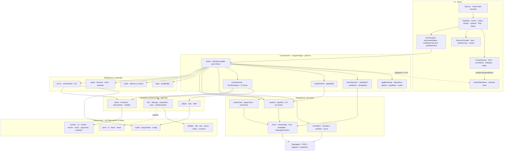

#### Qué hace cada bloque

| Bloque | Responsabilidad | Por qué está separado |
| --- | --- | --- |
| **UI React** | Rutas, pantallas, HUD, editor y store de estadísticas. | No simula ni toca el estado mutable; recibe snapshots. |
| **`Game`** | Fachada pública, bucle de frame y orquestación. | React mantiene una API estable aunque cambie el interior. |
| **`app/`** | Bootstrap, sesión de partida, mapa y hosts. | Es el único composition root; el grafo se construye una vez. |
| **`sim/`** | Avance determinista con paso fijo. | Testeable sin DOM, cámara ni PlayCanvas. |
| **`core/`** | Tipos, reglas y contratos puros. | Cero dependencias del motor; rompe el acoplamiento dominio-render. |
| **`render/`** | VFX, mundo, actores, niebla y cámaras. | Los cambios visuales no arrastran reglas de combate. |
| **Plataforma** | Input, audio, sprites, texturas y bots. | Adaptadores reemplazables y con estado propio. |

### 2. Regla de dependencias

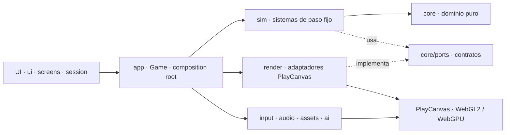

| Capa | Puede importar | No puede importar |
| --- | --- | --- |
| `core/**` | Solo `core/**` y tipos estándar. | `playcanvas`, `react`, `sim/**`, `render/**`, `app/**`, `ui/**`. |
| `sim/**` | `core/**`, contratos y utilidades puras. | `render/**`, `ui/**`, `screens/**`, `react`. |
| `render/**` | `core/**`, `core/ports`, PlayCanvas y utilidades visuales. | `ui/**`, `screens/**`, `session/**`. |
| `app/**` | Todas las capas: es el composition root. | Nada prohibido por diseño, pero mantiene la fachada delgada. |
| `ui/**`, `screens/**` | `Game`, view-models y stores públicos. | `sim/**` y detalles internos de `core/**`. |

`node scripts/check-architecture.mjs` verifica dirección de capas, ciclos de
runtime, ciclos de tipos y tamaño máximo de archivo. Hoy termina con
`Arquitectura OK` y sin ciclos.

### 3. Composition root: `Game`, `RuntimeState` y hosts

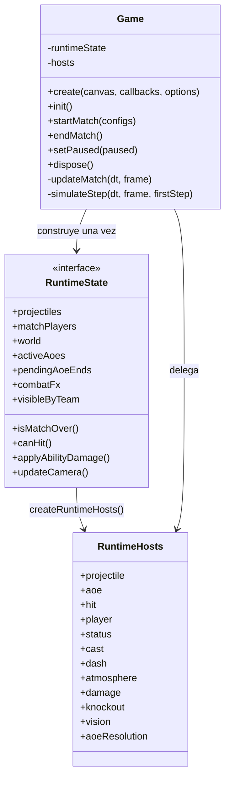

`Game` crea **un único** `RuntimeState` con getters y callbacks y, a partir de
él, **un único** `RuntimeHosts`. Los sistemas reciben su host, no la clase
completa: no hay `this.game` dentro de `sim/**`. Los getters existen porque el
estado se reemplaza en bloque al empezar o limpiar una partida (arrays nuevos),
y así los hosts siguen siendo estables.

| Host | Sistema | Responsabilidad |
| --- | --- | --- |
| `projectile` | `sim/projectiles` | Avance, colisión e impacto de proyectiles. |
| `aoe` | `sim/aoes` | Áreas `overTime` y `onEnd` diferidos. |
| `hit` | `sim/hits` | Golpes instantáneos, dash y melé diferidos. |
| `player` | `sim/player` | Movimiento, timers, cámara, respawn y casteo. |
| `status` | `sim/status` | Regeneración y goteo de participación. |
| `cast` | `sim/cast` | Reloj del casteo, pose de impacto y animación. |
| `dash` | `sim/dash` | Desplazamiento y sincronización del dash. |
| `atmosphere` | `sim/atmosphere` | Daño residual del clima. |
| `damage` | `sim/damage` | Inmunidad, fórmula, slow, buffs, escudo, XP y KO. |
| `knockout` | `sim/knockout` | KO, respawn, marcador y evento al modo. |
| `vision` | `render/visionView` | Niebla, copias visibles y máscara por equipo. |
| `aoeResolution` | `sim/aoeResolution` | Contexto de área, callbacks y eventos. |

### 4. Bucle de frame

El render corre a la tasa del navegador; la simulación avanza en pasos fijos de
`1/60 s`, con un máximo de pasos por frame para no entrar en espiral.

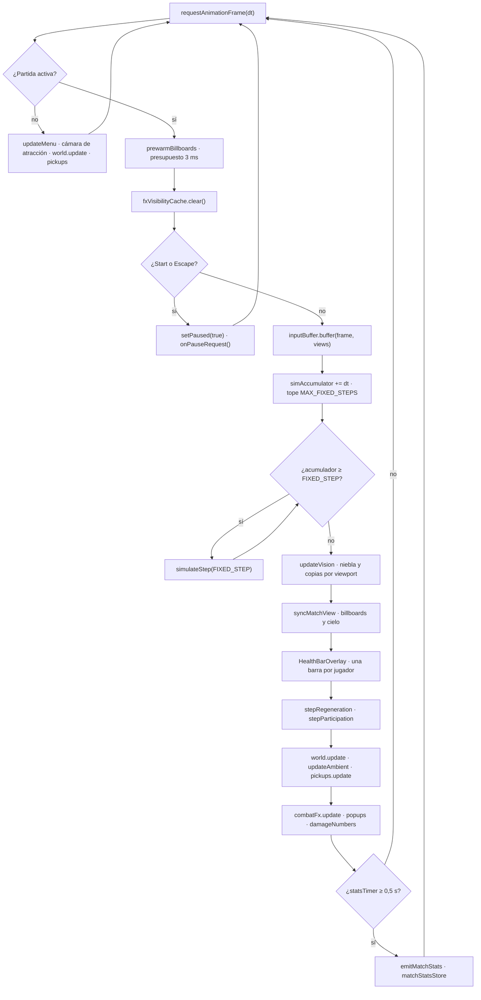

Puntos clave:

- `dt` del render no entra en las reglas: la simulación siempre ve `1/60`.
- Las acciones de borde (habilidades, rueda, giro) se acumulan en
  `inputBuffer` para no perderse en frames sin paso.
- La niebla se resuelve **antes** de sincronizar copias, así las copias ocultas
  no pagan posición, animación ni billboard.
- Las estadísticas del HUD salen a 2 Hz; React nunca lee estado mutable por
  frame.

### 5. Orden del paso fijo

El orden es parte del comportamiento: si cambia, cambian los intercambios y los
empates de daño.

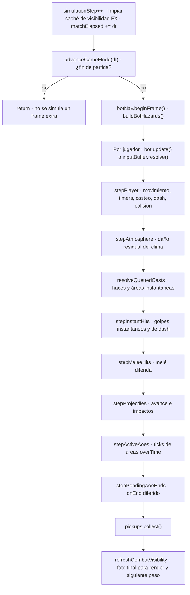

Cada fase comprueba `matchOver` antes de ejecutarse: un KO en un paso no deja
que las fases siguientes sigan aplicando daño en el mismo instante.

### 6. Ciclo de vida de una partida

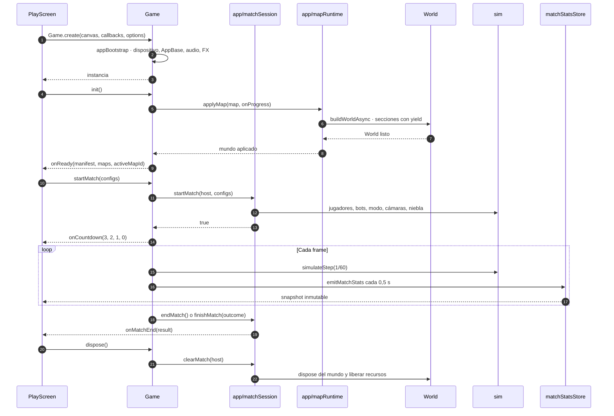

`Game` conserva la superficie pública que usa React:

```ts
Game.create(canvas, callbacks, options): Promise<Game>
game.init(): Promise<void>
game.startMatch(configs): boolean
game.endMatch(): void
game.setPaused(paused: boolean): void
game.dispose(): void
```

### 7. Ciclo de una habilidad

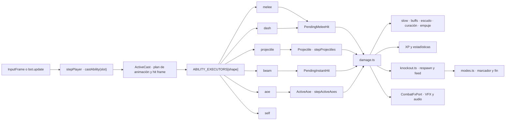

- `abilities.ts` es un catálogo **data-driven**: añadir una habilidad no toca el
  motor.
- `abilityExecutors.ts` es un **Strategy + Registry** por forma; añadir una
  forma nueva es registrar una función.
- `modes.ts` es un **Strategy** por modo (`tdm`, `koth`): `Game` solo reparte
  eventos y aplica el resultado.

### 8. IA de bots

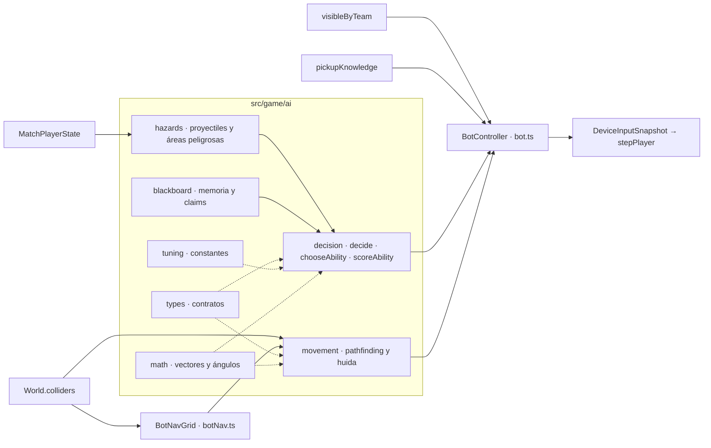

`BotController.update()` devuelve la misma instantánea de entrada que un humano.
Así la simulación tiene una sola ruta de entrada y los bots no reciben trato
especial dentro de `stepPlayer`.

### 9. Generación de mundo

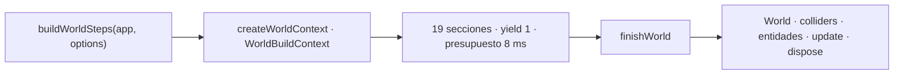

Secciones, en el orden real de ejecución:

| Grupo | Secciones |
| --- | --- |
| Base | `scene`, `lights`, `ground`, `water` |
| Biomas y decoración | `trees`, `barriers`, `desertDust`, `ice`, `fire`, `grass`, `flowers`, `butterflies`, `paramo`, `lightning`, `ghost` |
| Cierre | `bases`, `sky`, `weather`, `contactShadow` |

Módulos compartidos del generador:

| Módulo | Papel |
| --- | --- |
| `render/world/context.ts` | Estado compartido, salidas y disposables. |
| `render/world/random.ts` | RNG determinista. |
| `render/world/tuning.ts` | Constantes de generación. |
| `render/world/surfaces.ts` | Mallas de superficie reutilizables. |
| `render/world/foliage.ts` | Follaje instanciado, viento y paletas. |
| `render/world/butterfly.ts` / `lightning.ts` | Estado y animación de mariposas y rayos. |
| `render/world/worldTextures.ts` / `worldDetailTextures.ts` | Texturas procedurales troceadas. |
| `render/world/ambientParticles.ts` | Lotes ambientales. |
| `render/world/options.ts` / `types.ts` | Opciones, hooks y tipo `World`. |
| `render/world/pickupPlacement.ts` | Validación de posición de objetos. |

Se conservan los 26 `yield 1`, el consumo de azar, el orden de creación y la
limpieza determinista.

### 10. VFX

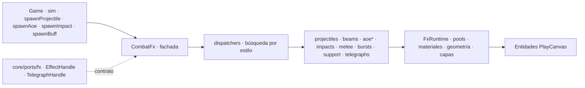

La fachada mantiene la API histórica. Las fábricas se eligen **al lanzar** el
efecto, no por frame. Los pools, materiales y la resolución de capas viven en
`FxRuntime`.

### 11. UI, HUD y editor

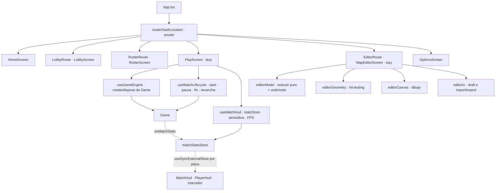

`PlayCanvas` y el editor se cargan con `lazy()`: el bundle principal no incluye
el motor 3D. `PlayScreen` compone hooks; no simula ni guarda estado del motor en
`useState`.

### 12. Mapa de carpetas

```text
src/
├─ main.tsx · App.tsx          # arranque y rutas
├─ router/                     # hash location
├─ session/                    # contexto, boot, preferencias
├─ screens/                    # pantallas y hooks de play
│  └─ play/                    # engine, lifecycle, HUD, stage, diálogos
├─ ui/                         # HUD, componentes y editor
│  └─ editor/                  # modelo, geometría, canvas, IO, toolbar
├─ performance/                # entrada del benchmark de frame
└─ game/
   ├─ game.ts                  # fachada Game
   ├─ app/                     # bootstrap, sesión, mapa, hosts
   ├─ core/                    # dominio puro y puertos
   │  ├─ abilities/            # def, aoe, specs, styles, common
   │  ├─ match/                # playerState y configuración
   │  ├─ ports/                # contratos de FX
   │  └─ __tests__/            # tests puros
   ├─ sim/                     # sistemas de paso fijo
   ├─ render/
   │  ├─ fx/                   # CombatFx y familias
   │  └─ world/                # pipeline, contexto y secciones
   ├─ ai/                      # módulos de decisión y navegación
   ├─ abilities.ts             # catálogo data-driven
   ├─ abilityExecutors.ts      # Strategy + Registry por forma
   ├─ modes.ts                 # Strategy por modo de juego
   ├─ matchState.ts            # estado mutable de la partida
   └─ world.ts                 # pipeline del generador de mundo
```

Tamaños actuales (sin tests):

| Zona | Líneas | Archivos |
| --- | ---: | ---: |
| `src/game/core` | 2.007 | 18 |
| `src/game/sim` | 2.202 | 12 |
| `src/game/app` | 1.108 | 3 |
| `src/game/ai` | 1.811 | 7 |
| `src/game/render` | 17.939 | 62 |
| `src/game` (total) | 56.494 | 166 |
| `src/ui` | 7.470 | 32 |
| `src/screens` | 2.074 | 12 |
| `src/session` | 954 | 3 |

Archivos que antes concentraban la arquitectura:

| Archivo | Antes | Ahora |
| --- | ---: | ---: |
| `game/combatFx.ts` | 13.069 | 15 (puente) |
| `game/game.ts` | 5.871 | 3.657 |
| `game/bot.ts` | 5.525 | 4.499 |
| `game/world.ts` | 4.046 | 361 |
| `ui/MapEditorScreen.tsx` | 2.189 | 1.191 |
| `screens/PlayScreen.tsx` | 954 | 322 |

### 13. Propiedad del estado

| Estado | Dueño | Consumidores |
| --- | --- | --- |
| `MatchPlayerState[]` | `game.ts` + `core/match/playerState` | `sim/**`, `render/**`, bots. |
| `PlayerView` (cámara, copias, barra, viewport) | `render/playerView` | `matchView`, `visionView`, overlay de barras. |
| `World` (colliders, entidades, update) | `world.ts` | Simulación, render, bots y objetos. |
| `RuntimeState` + `RuntimeHosts` | `app/runtimeHosts.ts` | Todos los sistemas. |
| `ActiveCast`, `Projectile`, `ActiveAoe` | `matchState.ts` | Sistemas de simulación y FX. |
| `visibleByTeam` | `sim/visibility` | Bots, regeneración y render. |
| `matchStatsStore` | `ui/matchStatsStore.ts` | Componentes del HUD. |
| Sesión y preferencias | `session/SessionProvider.tsx` | Pantallas y ajustes. |
| `EditorMap` e historial | `ui/editor/editorModel.ts` | Editor y tests. |

Regla: **el estado de simulación no contiene objetos de render**. La cámara,
las copias y las barras viven en el sidecar `PlayerView`; la simulación solo
guarda `cameraYaw` como número para la IA.

### 14. Guardarraíles y verificación

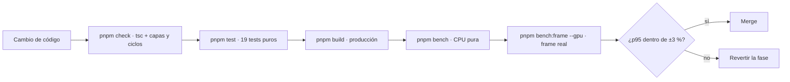

| Comando | Qué comprueba |
| --- | --- |
| `pnpm check` | TypeScript, dirección de capas, ciclos de runtime/tipos y tamaño máximo. |
| `pnpm test` | Daño, geometría de áreas, XP, modos, peligros de IA y modelo del editor. |
| `pnpm build` | Build de producción con `tsc -b` y Vite. |
| `pnpm bench` | Bucle de simulación puro en Node. |
| `pnpm bench:frame --all --seconds 5 --gpu` | FPS, p50/p95 y máximos reales en Chrome headless. |

Criterio de aceptación: mismos draw calls, ninguna tarea larga nueva, memoria
estable y p95 dentro del ±3 %. Las referencias están en `docs/rendimiento.md`.

### 15. Decisiones que explica el diagrama

1. **Monolito modular, no microservicios ni ECS.** El estado caliente sigue
   siendo plano y reutilizado; los patrones ordenan el código sin añadir
   indirección por frame.
2. **Un composition root.** `Game.create` construye el grafo una vez; no hay
   contenedor DI ni service locator.
3. **Puertos solo donde hacían falta.** `core/ports/fx.ts` rompe la dependencia
   dominio-render y se borra al compilar.
4. **Hosts explícitos.** Cada sistema declara lo que necesita; `Game` no se pasa
   a sí mismo como dios.
5. **Registros en el evento.** Habilidades, VFX, modos y secciones de mundo se
   resuelven al lanzar o al cargar, no en el bucle interno.
6. **React no simula.** El HUD recibe snapshots inmutables a 2 Hz y se suscribe
   por plaza con `useSyncExternalStore`.
7. **Todo se mide.** La arquitectura no es un fin: el p95 y los draw calls son
   criterios de aceptación.
