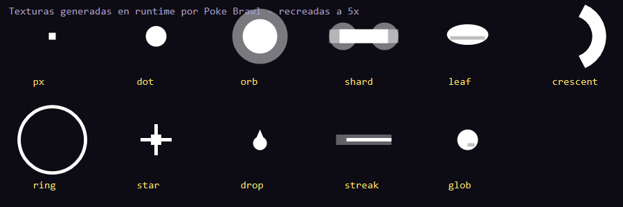

# Poke Brawl — investigación de assets de habilidades

Juego analizado: <https://unfoundgames.in/play/poke-brawl> (iframe de
<https://pokebrawl.vercel.app/>).

Fecha de la inspección: **2026-10-29**.
Bundle analizado: `assets/index-Cj-UV_Xn.js` (1 680 280 bytes) + `assets/index-B6zx9Ky8.css`.

## Resumen

**Poke Brawl no tiene assets de imagen para las habilidades.** No hay iconos,
hojas de efectos ni texturas de proyectiles: lo único gráfico son las hojas de
animación de los 8 Pokémon. Todos los efectos de las habilidades se dibujan en
tiempo de ejecución con Phaser 3.90 (Graphics + partículas) y **11 texturas
blancas generadas con `generateTexture`**. El audio también es sintetizado
(WebAudio), no hay `.mp3`/`.ogg`/`.wav`.

Consecuencia práctica: no hay nada que descargar de habilidades. Si se quieren
reutilizar, hay que **replicar las recetas de dibujo**, no copiar imágenes. Las
recetas están resumidas más abajo y los datos completos en
[`data.json`](./data.json).

## Inventario real de archivos

| Ruta | Qué es | ¿Habilidad? |
| --- | --- | --- |
| `/assets/index-Cj-UV_Xn.js` | Todo el juego (Phaser 3 + lógica) | — |
| `/assets/index-B6zx9Ky8.css` | Estilos del canvas y pantalla de rotar | — |
| `/sprites/<pokemon>/portrait.png` | Retrato 1 de los 8 Pokémon | No |
| `/sprites/<pokemon>/<Anim>-Anim.png` | Hojas de animación de personaje | No |
| `/manifest.webmanifest`, `/og.png`, iconos | PWA / compartir | No |

Comprobado que devuelven **404**:

- `https://pokebrawl.vercel.app/sprites/` (no hay listado)
- `https://pokebrawl.vercel.app/assets/` (no hay listado)
- `https://pokebrawl.vercel.app/sprites/fx/dot.png`
- `https://pokebrawl.vercel.app/sprites/pikachu/Thunderbolt-Anim.png`

### Sprites de personaje

Base: `https://pokebrawl.vercel.app/sprites/<id>/`

| Pokémon | Animaciones disponibles |
| --- | --- |
| `pikachu` | Attack, Charge, Double, Faint, Hop, Hurt, Idle, Pose, QuickStrike, Rotate, Shoot, Swing, Walk |
| `charizard` | Attack, Charge, Double, Faint, Hop, Hurt, Idle, Rotate, Shoot, Strike, Swing, Walk |
| `blastoise` | Attack, Charge, Double, Hop, Hurt, Idle, Rotate, Shoot, Swing, Walk |
| `venusaur` | Attack, Charge, Double, Hop, Hurt, Idle, Rotate, Shoot, Swing, Walk |
| `gengar` | Attack, Charge, Double, Faint, Hop, Hurt, Idle, Pose, Rotate, Shoot, Strike, Swing, Walk |
| `lucario` | Attack, Charge, Double, Faint, Hop, Hurt, Idle, Pose, QuickStrike, Rotate, Strike, Swing, Walk |
| `gardevoir` | Attack, Charge, Double, Hop, Hurt, Idle, Rotate, Swing, Walk |
| `garchomp` | Attack, Charge, Double, Hop, Hurt, Idle, Rotate, Shoot, Swing, Walk |

Son **90 PNG** de animación (8 personajes × 10-13 animaciones) + 8 retratos. El
formato es una tira horizontal por animación, al estilo PMD Sprite Collab. El
inventario exacto está en [`sprites.json`](./sprites.json).

## Sistema de habilidades

- **8 Pokémon**, cada uno con 3 estilos: `Classic` (sus 4 movimientos base) +
  2 estilos alternativos de 4 movimientos.
- **84 nombres únicos** de habilidad, **91 entradas** en total (algunas se
  repiten entre Pokémon, p. ej. `Dragon Claw`).
- Los datos de cada movimiento incluyen: `type`, `kind`, `power`, `cooldown`,
  `windup`, `recovery`, `anim`, `knockback`, `hitstun`, `aiRange` y parámetros
  propios de su forma (`speed`, `range`, `radius`, `shots`, `explode`...).
- Hay 5 estados: `burn`, `paralysis`, `poison`, `toxic`, `sleep`; buffs,
  escudos, trampas, rocas, drenaje, semillas, etc.

### Formas (`kind`) y su frecuencia

| `kind` | Nº | Comportamiento |
| --- | --- | --- |
| `projectile` | 38 | Proyectil que avanza; puede ser `beam`, `homing`, `shots`, `count`/`spread` |
| `dash` | 11 | Embestida con daño al paso |
| `melee` | 11 | Arco/cuadro delante del Pokémon |
| `buff` | 9 | Autobuff (velocidad, daño, defensa, curación, pantalla) |
| `nova` | 9 | Estallido circular centrado en el lanzador |
| `strike` | 4 | Área que cae tras un retardo (rayo, lodo, etc.) |
| `guard` | 3 | Bloqueo / contraataque |
| `phase` | 1 | Se desvanece y reaparece detrás del rival |
| `dig` | 1 | Baja bajo tierra y emerge |
| `rampage` | 1 | Ráfaga de golpes durante N segundos |
| `hazard` | 1 | Rocas persistentes en el suelo |
| `blink` | 1 | Teletransporte |
| `fly` | 1 | Vuelo / planeo |

### Formas (`shape`) de proyectil

Solo 10 movimientos definen `shape`; el resto usa `orb` por defecto.

- `shard` (6): Thunderbolt, Volt Switch, Ice Beam, Flash Cannon, Stone Edge...
- `crescent` (3): Air Slash, Hurricane, Vacuum Wave.
- `leaf` (1): Razor Leaf.

## Cómo se dibujan los efectos

### 1. Texturas generadas (11)

Se crean una sola vez al arrancar la escena, todas **blancas**, y luego se
tiñen con `setTint(color)`. Son estas:

| Clave | Tamaño | Dibujo |
| --- | --- | --- |
| `px` | 2×2 | Cuadrado relleno |
| `dot` | 6×6 | Círculo relleno r=3 |
| `orb` | 16×16 | Círculo al 45 % r=8 + círculo sólido r=5 |
| `shard` | 20×8 | Rectángulo redondeado r=4 + núcleo r=2 |
| `leaf` | 12×7 | Elipse + vena oscura |
| `crescent` | 16×16 | Arco de grosor 4 (media luna) |
| `ring` | 64×64 | Círculo de grosor 3, r=30 |
| `star` | 9×9 | Cruz/estrella de 4 puntas |
| `drop` | 4×6 | Círculo + triángulo (gota) |
| `streak` | 16×3 | Barra con degradado de alpha |
| `glob` | 6×6 | Círculo + muesca oscura |



*Recreación propia de las texturas (no es una captura del juego): todas se
generan en blanco y se tiñen en runtime.*

También se generan `raindrop`, `sandstreak` y otras texturas para clima y
terreno, pero no son de habilidades.

### 2. Capas de un efecto

Cada habilidad combina hasta cinco capas, todas con `BlendMode.ADD`:

1. **Impacto** — partículas según el tipo del movimiento (ver tabla).
2. **Carga / telegraph** — durante `windup`: partículas que entran al cuerpo,
   un `orb` que crece, anillos, etc.
3. **Golpe** — `arc` (abanico), `claws` (3 zarpazos), `shadowFist`, `jabs`.
4. **Proyectil** — la textura `shape`/`orb` teñida, con decoración (estela,
   anillos, zigzag, partículas que siguen).
5. **Estallido** — al impactar: `blast`/`crater`, onda, kanji de fuego, etc.

La profundidad se ordena por la `y` del mundo (`depth`), así que los efectos
quedan detrás/delante del sprite correctamente. No hay post-procesado ni shaders.

### 3. Impacto por tipo

| Tipo | Receta |
| --- | --- |
| `fire` | 12 `dot` naranjas/rojos hacia arriba + flash `orb` |
| `water` | 14 `drop` con gravedad + anillo azul |
| `electric` | 4 rayos `zigzag` (Graphics) alrededor + desvanecido 160 ms |
| `ice` | 9 `shard` giratorios con gravedad |
| `grass` | 8 `leaf` girando |
| `ghost` / `dark` | 9 `orb` que suben y se desvanecen (morado / oscuro) |
| `steel` | 18 `px` rápidos con gravedad y ADD |
| `fighting` | anillo naranja + `star` blanco |
| `dragon` | 10 `shard` giratorios |
| `fairy` | 10 `star` flotando |
| `psychic` | 2 anillos rosas/morados con retardo |
| `poison` | 10 `glob` con gravedad |
| `ground` | 14 `px` marrones con gravedad |
| `flying` | 6 `leaf` blancos girando |

`normal`, `bug` y `rock` no tienen impacto propio: solo el `hitSpark` genérico.

### 4. Recetas con nombre propio (22)

Estas habilidades no usan solo el impacto por tipo:

| Habilidad | Efecto |
| --- | --- |
| `Thunder` | Rayos zigzag alrededor durante la carga + columna al caer |
| `Solar Beam` | Orbe alargado vertical + partículas subiendo |
| `Moonblast` | Orbe rosa que crece + anillo; estela de `star` |
| `Psychic` | Anillos concéntricos periódicos |
| `Aura Sphere` | Partículas que suben desde una elipse + anillo pulsante; homing |
| `Earthquake` | Partículas de tierra + temblor de cámara |
| `Flash Cannon`, `Iron Tail` | `star` que crece y gira |
| `Dragon Claw` | 3 zarpazos en abanico (polígonos) |
| `Aqua Tail` | Arco de agua + gotas |
| `Shadow Punch` | Orbe oscuro que viaja + explosión |
| `Bullet Punch` | 3 destellos `star` + estela |
| `Phantom Force` | Arco morado |
| `Shadow Ball` | Orbe oscuro con 3 orbes orbitando |
| `Water Pulse` | Anillos de agua repetidos |
| `Thunderbolt` | Zigzags alrededor del proyectil |
| `Air Slash` | Estela `streak` orientada a la velocidad |
| `Hydro Pump` | Gotas con gravedad siguiendo el proyectil |
| `Fire Blast` | Kanji de fuego dibujado con 5 brazos de `orb` |
| `Close Combat` | Estela de `star` |
| `Dragon Rush` | Estela de `orb` |
| `Psybeam` | Haz ondulado de dos colores |
| `Ice Beam` | Haz azul + `star` de hielo |

Además, cualquier movimiento con `beam: true` dibuja un haz continuo con tres
pasadas (halo ancho, cuerpo de color, núcleo blanco).

### 5. Colores

Cada movimiento usa `color` si está definido; si no, el color de su tipo:

```json
{
  "normal": 11052922, "fire": 15630640, "water": 6525168,
  "electric": 16240684, "grass": 8046412, "ice": 9886166,
  "fighting": 12725800, "poison": 10698401, "ground": 14860133,
  "flying": 11112435, "psychic": 16340359, "bug": 10926362,
  "rock": 11968822, "ghost": 7559063, "dragon": 7288316,
  "dark": 7362374, "steel": 12040142, "fairy": 14058925
}
```

La tabla completa de tipos, la tabla de efectividad y los entornos
(clima/terreno: sol, lluvia, arena, oscuridad, hierba, eléctrico, niebla, aura)
están en [`data.json`](./data.json).

## Qué se puede reutilizar en NewPoke

NewPoke ya tiene un enfoque equivalente en 3D (`src/game/combatFx.ts`): mallas
de PlayCanvas con materiales aditivos. El mapeo directo sería:

| Poke Brawl `kind` | NewPoke `AbilityShape` |
| --- | --- |
| `projectile` | `projectile` |
| `beam` (`beam: true`) | `beam` |
| `melee` | `melee` |
| `nova`, `strike`, `hazard`, `rampage` | `aoe` |
| `dash`, `fly`, `phase`, `dig`, `blink` | `dash` |
| `buff`, `guard` | `self` |

Para llevar las 11 texturas al motor 3D hay dos opciones:

1. **Billboards**: generar las mismas texturas en un canvas y usarlas en quads
   que miran a cámara. Es lo más fiel al original.
2. **Primitivas**: sustituir `dot`/`orb`/`star` por esferas, `ring` por toros,
   `streak` por cajas alargadas y `shard`/`leaf` por planos girados. Es lo que
   ya hace `combatFx.ts`; pierde el detalle de las partículas pero encaja con
   el estilo 3D.

Los datos de `data.json` se pueden convertir a `AbilityDef` sin tocar el motor:
`power` y `cooldown` son directamente utilizables; `range`/`radius` están en
píxeles de un mundo 2D de ~960×540 y habría que escalarlos a unidades de mundo
de PlayCanvas.

## Cómo se extrajo

```powershell
$d = "$env:TEMP\pokebrawl"
Invoke-WebRequest "https://pokebrawl.vercel.app/" -OutFile "$d\index.html"
Invoke-WebRequest "https://pokebrawl.vercel.app/assets/index-Cj-UV_Xn.js" -OutFile "$d\index.js"
```

Luego se buscan los literales del bundle:

- `sprites/` → hojas de personaje.
- `Et=[{id:"pikachu"` → tabla de Pokémon y movimientos.
- `const zt={normal:` → colores de tipo.
- `Vh={` → tabla de efectividad.
- `const Wt={sun:` → climas y terrenos.
- `function Bl(D)` → generador de las 11 texturas.
- `class Il` → sistema de VFX (impacto, carga, golpe, proyectil, estallido).

## Archivos

- [`data.json`](./data.json) — Pokémon, stats, movimientos, estilos, colores,
  tabla de tipos y entornos.
- [`moves.md`](./moves.md) — las mismas habilidades en tablas legibles.
- [`sprites.json`](./sprites.json) — inventario de hojas de animación y base URL.

## Nota legal

Poke Brawl es un proyecto fan no oficial. Los sprites y el código pertenecen a
sus autores; este documento es un análisis técnico para estudio. No conviene
redistribuir los PNG ni el bundle como assets propios.
